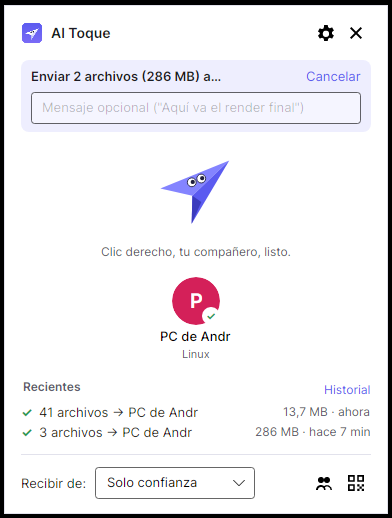
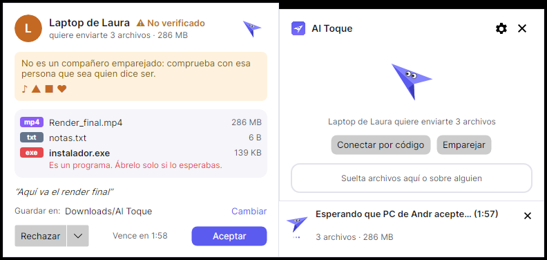
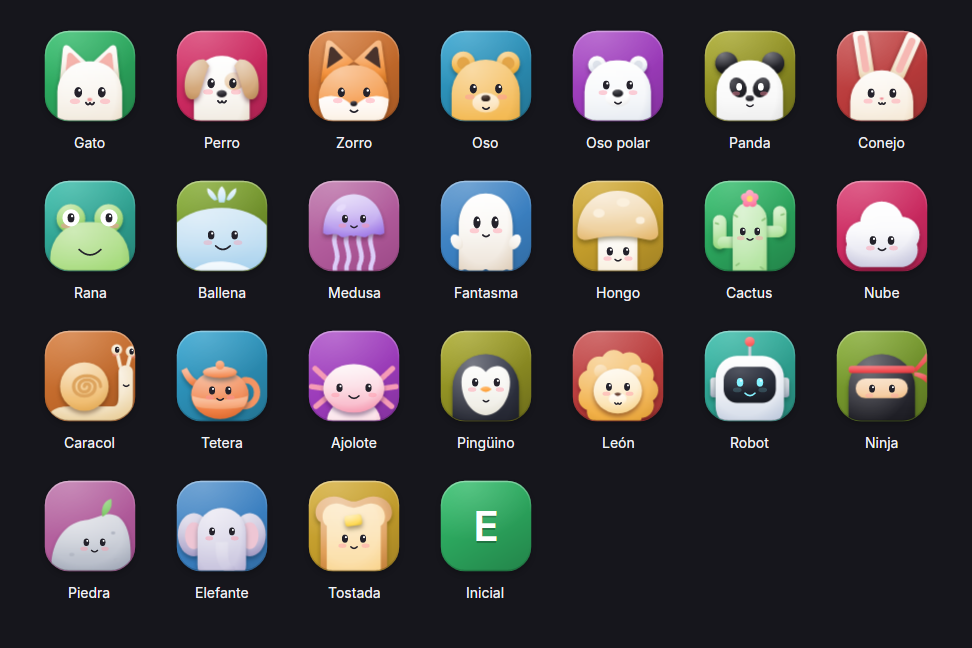
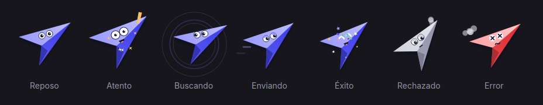
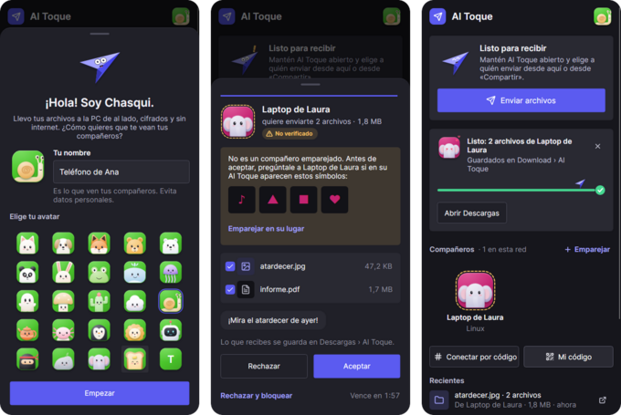

# Al Toque

Envía cualquier archivo a otra PC o a tu teléfono con un clic derecho. El receptor confirma, la transferencia viaja
cifrada por tu red local y **Chasqui**, un avión de papel con ojos, acompaña cada envío. Funciona en **Windows**,
**Linux**, **macOS** y **Android**, y todos se entienden entre sí.

*Clic derecho → nombre de tu compañero → listo.* Sin cuentas, sin internet y sin escribir direcciones IP.

<p>
  
  
</p>

Cada equipo elige su **avatar**: un personaje que parpadea, mira, salta al pasar el ratón y celebra cuando llega algo.
El fondo es siempre el color de su identidad.

<p></p>

Y **Chasqui** tiene una cara para cada momento: se agacha antes de despegar, da una vuelta al terminar con confeti,
se encoge de hombros si rechazan el envío y se marea si algo falla.

<p></p>

En el teléfono, la misma app: compañeros, enviar desde la app o desde **Compartir** de cualquier otra, recibir en
*Descargas › Al Toque*, emparejar con el código de 6 cifras y conectar por código.

<p></p>

La especificación completa está en [`docs/especificacion.md`](docs/especificacion.md) (escrita con el nombre de trabajo
"Pásalo"; el producto se llama **Al Toque**).

## Estado

Primera versión: **Windows** (x64 y ARM64) como plataforma principal, **Linux** y **macOS** con la misma app de escritorio,
y **Android** 11 o posterior con una app propia para el teléfono. Todas hablan el mismo protocolo.

| Área | Hecho |
|---|---|
| Descubrimiento | UDP multicast `239.255.45.83:45832` (TTL 1) + broadcast dirigido; anuncios cada 30–60 s, consulta al abrir el panel, `BYE` al salir; límites contra saturación; compañeros conocidos al instante desde caché ("verificando…") |
| Identidad | Clave ECDSA P-256 por equipo; `deviceId` = 128 bits del SHA-256 de la clave; color y símbolos de huella; clave privada protegida con DPAPI |
| Canal | TLS 1.3/1.2 **mutuo** con claves fijadas, ALPN `altoque/1`, solo cifrados AEAD con ECDHE; la identidad sale del certificado, nunca del JSON |
| Recepción | Modos **Nadie** · **Solo confianza** · **Todos durante 10 minutos** (vuelve solo); tarjeta de aceptación con quién, verificación, archivos, advertencias y mensaje; cambiar carpeta; rechazar y bloquear; aceptación automática por compañero |
| Receptor blindado | Máquina de estados estricta, tokens de un solo uso por archivo, saneamiento de rutas (recorrido, nombres reservados, `:`/ADS, controles y bidi), `.altoque-part` + SHA-256 + renombrado atómico, Mark of the Web (`Zone.Identifier`, ZoneId=3), espacio libre, cuotas y plazos |
| Envío | Archivos y carpetas (incluidas las vacías), 1 a 4 conexiones de datos, **modo ráfaga** para miles de archivos pequeños, hash al vuelo, fechas originales, mensaje opcional, cancelar desde cualquiera de los dos lados. **Se reanuda solo tras un corte** (cambio de Wi-Fi, suspensión breve): se reconecta en la dirección nueva y cada archivo sigue desde donde quedó, verificado de punta a punta con SHA-256. **Sin copias "(1)"** cuando llega exactamente lo mismo que ya estaba |
| Emparejamiento | Código de **6 dígitos** comparado en ambas pantallas, con compromiso previo (contra intermediarios); bloqueo de 5 min tras 3 fallos. **Conectar en 3 clics**: en redes privadas los equipos cercanos se ven por nombre en **«Cerca de ti»**; tocas uno, la otra persona pulsa «Conectar» en el aviso con el código y tú confirmas que coincide, sin abrir «Emparejar» en ninguno. Lo que tenías para enviar sale al quedar conectados. Con límites: 3 solicitudes por minuto, 10 min de espera tras «Ahora no», nada en «Nadie» ni en redes públicas, y se puede apagar en Ajustes |
| Chats | Una conversación por compañero de confianza (por identidad: no se duplica al cambiar de red o de nombre; si reinstaló, se ofrece unir su chat anterior); mensajes guardados en disco **cifrados** (AES-GCM, llave protegida por el sistema) antes de mostrarse; lo escrito sin conexión llega al volver; **un solo enlace por pareja** con señal de vida que se rehace solo al cambiar de red; ✓✓ entregado; los archivos que se mandan quedan en el chat y las **fotos se ven en la conversación** (miniaturas con la orientación de la cámara, visor con anterior/siguiente); **Ctrl+V** pega una captura o archivos copiados; **chat fijado en la esquina**, siempre encima, que se recuerda al reiniciar; no leídos en la tarjeta, la bandeja y el título; aviso flotante con **Responder** |
| Grupos y envío a varios | Grupos locales de compañeros (oficina, sesión, familia…) como fichas que filtran el panel; se arma arrastrando una tarjeta a la ficha o desde el menú del compañero; renombrar, archivar o eliminar con clic derecho. **Enviar lo mismo a varios** con *Seleccionar* (o Ctrl+clic), a un grupo entero (clic derecho o soltando archivos sobre su ficha), con **una sola tarjeta de progreso conjunto**: quién ya lo tiene, quién no y *Reintentar* solo con los que fallaron |
| Conexión manual | Por IP o por **código de conexión** (`K7Q2-9XM4`) para redes que bloquean el multicast |
| Windows | Menú clásico **"Enviar con Al Toque ›"** con tus compañeros (sin firma ni DLL, en `HKCU`), **"Enviar a"**, inicio con Windows, regla de firewall solo para redes privadas, pausa en redes públicas, sonidos y "reducir movimiento" del sistema |
| Interfaz | Sistema visual propio con tokens claro/oscuro e íconos de trazo; panel rápido (reposo, arrastrando, "no veo a nadie" con consejos y nombre de la red), tarjetas flotantes por estado con la estela de Chasqui como barra de progreso, solicitud grande o compacta con **aceptación parcial** (los programas llegan desmarcados), emparejamiento en 3 pasos, ajustes por tarjetas, historial con **Reintentar** |
| Avatares | 24 personajes vectoriales con volumen suave, elegibles en la bienvenida y en Ajustes; parpadean, miran, saltan, celebran y cambian de cara según el momento; viajan dentro del `HELLO` cifrado y, para los compañeros de confianza, solo se aceptan por TLS |
| Movimiento | Chasqui con expresiones, anticipación, aplastar y estirar, looping, confeti, estrellas, humo y gotas; entradas en cascada y sacudidas; curvas y duraciones del diseño; "Animaciones: como en Windows / completas / reducidas"; nada se anima con la ventana oculta |
| Linux | AppImage que se actualiza sola, `.tar.gz` portable, inicio con la sesión (`autostart`), x64 y ARM64 |
| macOS | App `.app` (Apple Silicon e Intel), instalador `.pkg` que se actualiza solo, ícono en la barra de menús, inicio con la sesión (LaunchAgent) |
| Android | App para el teléfono con el mismo diseño: compañeros, **Compartir** desde cualquier app, recibir en Descargas › Al Toque (aparece en la galería), emparejar, conectar por código, servicio en primer plano mientras pasan archivos, aviso de versión nueva |
| Distribución | NativeAOT (sin .NET instalado), modo portable (`portable.flag`), instaladores y actualizaciones con Velopack en Windows, Linux y macOS, APK para Android, CI en GitHub Actions con pruebas en las cuatro plataformas (Android en un emulador) |

Pendiente para próximas versiones (ver la hoja de ruta de la especificación): reanudar tras cerrar la app o reiniciar
el equipo, pausa manual, conectar el teléfono con un QR, notificaciones nativas del Windows App SDK, miniaturas en las solicitudes,
inglés revisado, integración con gestores de archivos de Linux y Finder, firma de código en Windows y macOS, recibir
en Android con la app cerrada, IPv6 en el descubrimiento.

## Instalar

Descarga lo que corresponda desde *Releases* (o desde **Actions → Compilar y probar → Artifacts**):

| Sistema | Archivo | Se actualiza sola |
|---|---|---|
| Windows | `AlToque-win-x64-Setup.exe` (o `win-arm64`) · portable: `AlToque-…-win-x64-portable.zip` | Sí (la instalada) |
| Linux | `AlToque-linux-x64.AppImage` (o `linux-arm64`) · portable: `AlToque-…-linux-x64-portable.tar.gz` | Sí (el AppImage) |
| macOS | `AlToque-osx-arm64-Setup.pkg` (Apple Silicon) u `osx-x64` (Intel) · app suelta: `AlToque-…-osx-arm64.zip` | Sí (la del `.pkg`) |
| Android | `AlToque-…-android.apk` (Android 11 o posterior) | Avisa y descarga el APK nuevo |

Las instrucciones paso a paso para cada sistema están en [`docs/INSTALAR.md`](docs/INSTALAR.md).

## Uso

1. Abre Al Toque en las dos PC. Elige cómo te verán tus compañeros.
2. **Conéctense**: en el panel, toca al otro equipo en *Cerca de ti*; a la otra persona le aparece un aviso con un código de
   6 cifras y pulsa *Conectar*; tú confirmas que ves el mismo código. (Con versiones anteriores: *Emparejar* en los dos.)
3. Desde entonces: **clic derecho** sobre archivos o carpetas → *Mostrar más opciones* (Windows 11) → **Enviar con Al Toque** → tu compañero.
4. Clic en un compañero de confianza abre **su chat**: escríbele, arrastra archivos o fotos a la conversación, usa el
   clip o pega una captura con **Ctrl+V**. Lo que se manden queda ahí, también tras reiniciar. Con el 📌 del chat, la
   conversación se queda **fijada en la esquina** de la pantalla, encima de todo, hasta que la minimices.

La ventana no se pierde: **—** y **×** la minimizan a la barra de tareas, y para cerrar Al Toque del todo está
*Salir de Al Toque* (clic derecho en su botón de la barra de tareas, en el ícono de la bandeja o en Ajustes).

Para alguien que todavía no es de confianza, el receptor activa **Recibir de: Todos (10 min)**; la solicitud llega
marcada como *No verificado*. Si la red no deja que los equipos se encuentren (Wi-Fi de invitados), usa *Mi código* y
*Conectar por código*.

### Línea de comandos

```text
AlToque send --to "PC de Andrés" [--message "texto"] <rutas…>
AlToque send --pick <rutas…>      Elegir destino en el panel
AlToque send --code <rutas…>      Conectar por código o IP
AlToque show | quit
AlToque unintegrate               Quitar el menú contextual y el inicio automático
```

El CLI entrega las rutas al agente residente por una tubería con nombre limitada al usuario actual y termina en
milisegundos; si el agente no está corriendo, lo inicia.

## Compilar

Requisitos: [.NET 10 SDK](https://dotnet.microsoft.com/download).

```bash
dotnet test tests/AlToque.Core.Tests                         # 89 pruebas, incluidas dos instancias reales hablando por TLS
dotnet run --project src/AlToque                             # la app de escritorio en modo desarrollo
dotnet run --project tools/AlToque.MobilePreview             # la app de Android en una ventana del tamaño de un teléfono
dotnet run --project tools/AlToque.MobilePreview -- --selftest   # emparejar y enviar entre dos agentes, y salir
```

La app de Android necesita además la carga de trabajo `android` y el SDK de Android:

```bash
dotnet workload install android
dotnet build src/AlToque.Android -t:InstallAndroidDependencies -f net10.0-android -p:AcceptAndroidSDKLicenses=true
dotnet publish src/AlToque.Android -c Release -f net10.0-android     # → com.krostgames.altoque-Signed.apk
```

Publicar para Windows con NativeAOT (en Windows, con las herramientas de C++ de Visual Studio):

```powershell
dotnet publish src/AlToque -c Release -r win-x64 -o publish
New-Item publish/portable.flag   # opcional: modo portable, guarda todo junto al .exe
```

El flujo de GitHub Actions ([`.github/workflows/build.yml`](.github/workflows/build.yml)) corre las pruebas en Linux y
Windows, publica con NativeAOT `win-x64`, `win-arm64`, `linux-x64`, `linux-arm64`, `osx-arm64` y `osx-x64`, hace
pruebas de humo del agente en Windows, Linux y macOS, compila el APK de Android y lo prueba en un emulador (dos agentes
del teléfono se emparejan y se pasan un archivo por TLS), y sube como artefactos los portables, los instaladores de
Velopack y el APK.

### Publicar una versión

Las copias instaladas buscan versiones nuevas en *Releases* y se actualizan solas (Velopack, un canal por sistema y
arquitectura: `win-x64`, `win-arm64`, `linux-x64`, `linux-arm64`, `osx-arm64`, `osx-x64`); la app de Android avisa y
descarga el APK. Para publicar una:

1. **Actions → Compilar y probar → Run workflow**, elige la rama y escribe la versión (por ejemplo `0.2.0`), o bien
   sube una etiqueta: `git tag v0.2.0 && git push origin v0.2.0`.
2. El flujo compila, prueba y crea la versión `v0.2.0` en GitHub con los instaladores, los paquetes de actualización
   de todos los canales, los portables y el APK.
3. En las próximas horas cada Al Toque instalado la descarga y avisa con **Reiniciar y actualizar** (o se instala al
   cerrar la app).

Cada versión debe ser mayor que la anterior. Las compilaciones sin versión usan `0.1.<n.º de ejecución>`, así que
conviene publicar a partir de `0.2.0`.

**Firma del APK.** Para que cada APK nuevo se instale encima del anterior, todos deben ir firmados con la misma llave.
Crea una una sola vez y guárdala como secretos del repositorio (*Settings → Secrets and variables → Actions*):

```bash
keytool -genkeypair -v -keystore altoque.keystore -alias altoque -keyalg RSA -keysize 4096 -validity 10000
base64 -w0 altoque.keystore   # → secreto ANDROID_KEYSTORE_BASE64
```

y los secretos `ANDROID_KEYSTORE_PASSWORD` (la contraseña) y `ANDROID_KEY_ALIAS` (`altoque`). Sin ellos el APK sale
con una firma de depuración distinta en cada compilación.

Para desarrollar con dos instancias en el mismo equipo, cada una con sus propios datos:

```bash
ALTOQUE_HOME=/tmp/a dotnet run --project src/AlToque
ALTOQUE_HOME=/tmp/b dotnet run --project src/AlToque
```

## Arquitectura

```text
src/AlToque.Core      Núcleo sin interfaz (compatible con NativeAOT)
  Security/           Identidad, DPAPI, sellado HMAC de la configuración, huella visual
  Storage/            Ajustes, lista de confianza, caché de direcciones, historial
  Discovery/          Anuncios UDP, directorio de compañeros, código de conexión
  Protocol/           Tramas [u32 longitud][u8 tipo][contenido], mensajes JSON estrictos, conexión TLS mutua
  Transfer/           Emisor, servidor receptor, saneamiento de nombres, plan de recepción, escritura segura
  Chat/               Conversaciones cifradas en disco y el enlace permanente con cada compañero
  Pairing/            Emparejamiento con compromiso y código de 6 dígitos
  Ipc/                Tubería local entre el CLI y el agente
  Agent/              AgentHost: orquesta todo lo anterior
src/AlToque.UI        Diseño compartido por escritorio y teléfono (Avalonia 12)
  Chasqui/            Chasqui: pintor vectorial con expresiones y control animado por estados
  Controls/           Avatares, íconos, pista de progreso, control segmentado, partículas y animaciones
  Theme/              Tokens de color, tipografía y estilos (claro y oscuro)
  Localization/       Textos en español e inglés
  ViewModels/         Compañeros, transferencias, solicitudes e historial
src/AlToque           App de escritorio (Windows, Linux y macOS)
  Views/, ViewModels/ Panel, tarjetas de solicitud y progreso, ventanas
  Platform/           Menú contextual, "Enviar a", firewall, red pública, inicio con la sesión, actualizaciones
src/AlToque.Mobile    App del teléfono, independiente del sistema: pantalla, hojas, preparación de archivos, autoprueba
src/AlToque.Android   Lo propio de Android: Compartir, Descargas y galería, Wi-Fi, servicio en primer plano
tests/                xUnit: saneamiento, tramas, códigos, sellado, ataques simulados y envíos reales
tools/AlToque.Gallery Capturas sin ventana (Avalonia.Headless) de avatares, Chasqui y la pista de progreso
tools/AlToque.MobilePreview  La app de Android en una ventana de escritorio, con su autoprueba
```

Un solo proceso hace de agente y de interfaz; las ventanas se crean la primera vez que hacen falta y luego solo se
ocultan. Datos locales: `%APPDATA%\AlToque` en Windows, `~/.config/altoque` en Linux, `~/Library/Application Support/AlToque`
en macOS, la carpeta privada de la app en Android (o `AlToque.data` junto al ejecutable en modo portable).

### Protocolo en breve

1. Descubrimiento: el anuncio UDP es solo una pista; un equipo se marca como verificado únicamente tras el apretón de
   manos TLS, comprobando que su clave corresponde al `deviceId` anunciado o a la clave fijada.
2. Control: `HELLO` → `OFFER` (manifiesto) → `DECISION` (con un token aleatorio por archivo aceptado).
3. Datos: 1 a 4 conexiones TLS del mismo emisor; cada archivo es `STREAM_OPEN` (token) → `CHUNK`… → `FILE_END`
   (SHA-256) → `FILE_RESULT`. Los archivos pequeños van seguidos por el mismo flujo, sin esperar respuesta.
4. Enlace de chat (solo entre compañeros de confianza): `HELLO` con propósito `link` → cada lado manda `CHAT_SYNC`
   ("tengo tus mensajes hasta el N") → `CHAT_MESSAGE` con id y número de orden del autor → `CHAT_ACK`. `PING`/`PONG`
   cada 15 s; si los dos marcan a la vez, queda la conexión que inició el `deviceId` menor.

### Decisiones respecto a la especificación

- **Notificaciones**: tarjetas propias (Avalonia) en lugar del Windows App SDK, que la especificación marca como riesgo
  con NativeAOT y sin paquete. Tienen botones, cuenta regresiva y progreso, y no roban el foco.
- **Chasqui y avatares**: dibujados con vectores y animados por código (poses, expresiones y partículas calculadas en
  cada fotograma, sin Lottie). Solo se pide un fotograma cuando algo se mueve: en reposo, Chasqui se queda quieto a los
  pocos segundos y los avatares guardan su cuerpo en un mapa de bits y solo repintan la cara al parpadear.
- **Clave privada**: PKCS#12 protegido con DPAPI del usuario (las claves CNG no exportables quedan para cuando haya
  firma de código).
- **Puertos**: TCP 45831 (si está ocupado, otro libre que se anuncia) y UDP 45832, no registrados en IANA.

## Seguridad

Ver la sección 12 de la especificación. Para reportar un fallo, abre un *issue* privado (*Security advisory*) en este
repositorio.

## Licencia

Código abierto bajo la [licencia MIT](LICENSE).

**KrostGames • Eduardo Mogollon Salcedo 2026**
