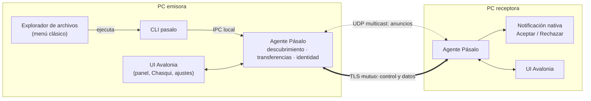
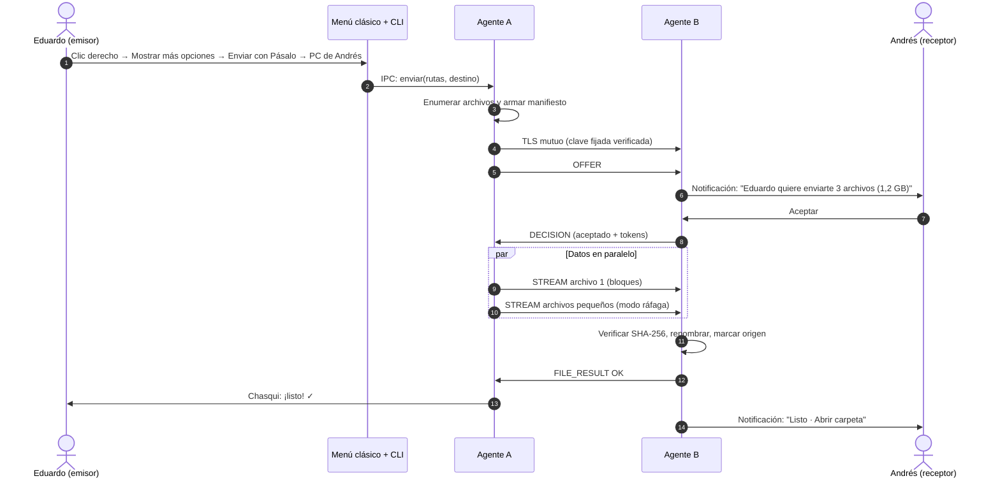
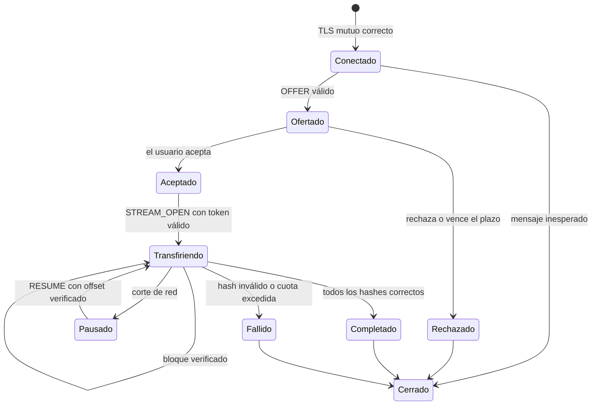
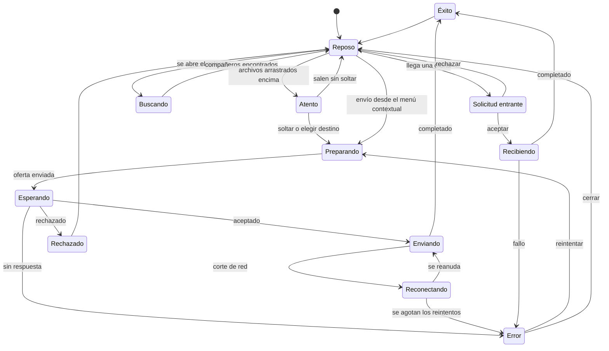

# Pásalo — Especificación de producto y técnica

> **Nombre de trabajo.** Herramienta de escritorio para Windows, macOS y Linux que envía cualquier archivo a otra PC de la misma red con un clic derecho. El receptor confirma, la transferencia viaja cifrada y un asistente animado, **Chasqui**, acompaña cada envío.
>
> *Chasqui* es el nombre de los mensajeros que corrían por los caminos del Imperio inca llevando recados de relevo en relevo. Ambos nombres son provisionales.

| | |
|---|---|
| Versión del documento | 0.1 (borrador) |
| Fecha | 29 de octubre de 2026 |
| Estado | Para revisión |
| Plataforma prioritaria | Windows 11 → luego macOS y Linux |

---

## Índice

0. [Resumen ejecutivo](#0-resumen-ejecutivo)
1. [Visión y principios](#1-visión-y-principios)
2. [Alcance](#2-alcance)
3. [Usuarios y escenarios](#3-usuarios-y-escenarios)
4. [Requisitos funcionales](#4-requisitos-funcionales)
5. [Requisitos no funcionales](#5-requisitos-no-funcionales)
6. [Arquitectura](#6-arquitectura)
7. [Stack tecnológico](#7-stack-tecnológico)
8. [Protocolo de red](#8-protocolo-de-red)
9. [Integración con el sistema operativo](#9-integración-con-el-sistema-operativo)
10. [Diseño de experiencia e interfaz](#10-diseño-de-experiencia-e-interfaz)
11. [Chasqui, el asistente de envíos](#11-chasqui-el-asistente-de-envíos)
12. [Seguridad](#12-seguridad)
13. [Rendimiento: cómo se logra la sensación de rapidez](#13-rendimiento-cómo-se-logra-la-sensación-de-rapidez)
14. [Empaquetado, distribución y actualizaciones](#14-empaquetado-distribución-y-actualizaciones)
15. [Pruebas y calidad](#15-pruebas-y-calidad)
16. [Hoja de ruta](#16-hoja-de-ruta)
17. [Riesgos y decisiones abiertas](#17-riesgos-y-decisiones-abiertas)
18. [Referencias](#18-referencias)

---

## 0. Resumen ejecutivo

Las diez decisiones que hacen que la herramienta se sienta **rápida, fácil y portable**, y que sea **segura**:

| # | Decisión | Por qué importa |
|---|---|---|
| 1 | Un **agente residente** ligero (ícono en la bandeja) que ya está escuchando y ya conoce a tus compañeros | El clic derecho solo le entrega los archivos a un agente que ya está listo: nada tiene que arrancar |
| 2 | **C# / .NET 10 con NativeAOT + Avalonia 12** | Arranque casi instantáneo, binario único sin runtime instalado, la misma interfaz en los tres sistemas y aprovechas tu experiencia en C# |
| 3 | **Clic derecho sin firma**: menú clásico con un submenú de tus compañeros, más "Enviar a" | "Clic derecho → Enviar con Pásalo → PC de Andrés" sin certificados ni permisos de administrador. En Windows 11 aparece dentro de "Mostrar más opciones" |
| 4 | **Distribución portable** (un `.exe`) e instalador con Velopack; la Microsoft Store queda como opción futura | No exige firma para empezar. Si más adelante se publica en la Store, la firma es gratis y se habilita el menú moderno de Windows 11 |
| 5 | **Aceptar desde la notificación**, con botones y barra de progreso | El receptor no tiene que abrir nada |
| 6 | **La identidad de cada PC es una clave criptográfica**, nunca su IP ni su nombre | Evita la suplantación de dispositivos que afectó a LocalSend en 2025 |
| 7 | **TLS mutuo con claves fijadas** + emparejamiento con código de 6 dígitos | Nadie en la red puede leer ni alterar el archivo en tránsito |
| 8 | **Receptor blindado**: máquina de estados estricta, nombres saneados, Mark of the Web | Evita los fallos que permitieron a Quick Share recibir archivos sin aceptación |
| 9 | **Transferencia en streaming** con hash al vuelo, reanudación por bloques y "modo ráfaga" para miles de archivos pequeños | Empieza al instante, aprovecha toda la red y sobrevive a cortes |
| 10 | **Asistente animado con máquina de estados** (Lottie + animaciones de Avalonia) que respeta "reducir movimiento" | Comunica de un vistazo qué está pasando: enviando, falló, recibido |

---

## 1. Visión y principios

**Visión:** *"Clic derecho → nombre de tu compañero → listo."* Mandar un archivo a la PC de al lado debe tomar menos tiempo que buscar una memoria USB.

**Principios**, en orden de prioridad cuando entran en conflicto:

1. **Seguro por defecto.** Nunca se recibe nada sin consentimiento, nada viaja sin cifrar y la identidad de cada equipo es verificable.
2. **Cero fricción.** Dos clics para enviar y uno para aceptar. Sin cuentas, sin internet, sin escribir direcciones IP.
3. **Instantáneo.** La interfaz responde en menos de 100 ms y la transferencia arranca apenas el receptor acepta.
4. **Ligero y portable.** Un ejecutable, sin dependencias instaladas, poco consumo en reposo.
5. **Encantador.** Chasqui comunica el estado con animaciones claras, sin estorbar ni ralentizar.
6. **Honesto.** Los errores explican la causa y ofrecen la solución: *"Tu red bloquea la detección automática. Conéctate con un código."*

---

## 2. Alcance

### 2.1 Objetivos (v1)

- Enviar archivos y carpetas de cualquier tamaño entre PCs con Windows, macOS y Linux en la misma red local.
- Confirmación explícita del receptor, con nombres, tamaños y tipos visibles antes de aceptar.
- Integración con el menú contextual (menú clásico y "Enviar a" en Windows), la bandeja del sistema y las notificaciones nativas.
- Emparejamiento de "compañeros de confianza".
- Reanudación de transferencias interrumpidas.
- Envío a varios destinatarios a la vez.

### 2.2 Fuera de alcance (v1)

- Transferencias por internet, atravesar NAT o usar servidores de retransmisión.
- Móviles (Android/iOS). Se evalúa en v2, posiblemente con un puente compatible con LocalSend.
- Sincronización continua de carpetas.
- Wi-Fi Direct o Bluetooth para equipos sin red compartida.
- Cuentas o servicios en la nube.

---

## 3. Usuarios y escenarios

### 3.1 Perfiles

| Perfil | Situación típica |
|---|---|
| **Oficina** | Laura, diseñadora, manda un video de 4 GB a Andrés, que está en el escritorio de al lado. Ambos en el Wi-Fi de la oficina. |
| **Desarrollador** | Eduardo pasa builds de Unity (APK o carpetas con miles de archivos) a otra PC de pruebas. |
| **Casa** | Pasar fotos de la laptop al PC de escritorio. |
| **Aula o laboratorio** | Un profesor envía material a 20 PCs a la vez. |

### 3.2 Escenarios clave

| ID | Escenario | Resultado esperado |
|---|---|---|
| E1 | Clic derecho sobre uno o varios archivos → **Enviar con Pásalo** → PC de Andrés (en Windows 11, dentro de "Mostrar más opciones") | A Andrés le aparece una notificación, acepta y ambos ven el progreso. Menos de 5 s desde el clic hasta que empiezan a moverse los datos, contando la aceptación. |
| E2 | Arrastrar archivos al panel de la bandeja y soltarlos sobre el avatar de un compañero | Mismo flujo que E1 |
| E3 | Recibir sin abrir la app | Se acepta desde la notificación |
| E4 | La laptop se suspende a mitad de una transferencia | Al volver, se reanuda desde el último bloque verificado |
| E5 | El compañero no aparece en la lista | Chasqui diagnostica la causa y ofrece conectar por código o por IP |
| E6 | Enviar a "Laboratorio 3" | Una sola acción llega a todos los equipos del grupo |
| E7 | Recibir de alguien que no es de confianza | El receptor activa "Recibir de todos durante 10 minutos" y la solicitud se marca como **no verificada** |

---

## 4. Requisitos funcionales

Prioridades: **MVP** (primera versión usable), **v1** (lanzamiento público), **v2** (posterior).

### 4.1 Descubrimiento

| ID | Requisito | Prioridad |
|---|---|---|
| RF-01 | Detectar automáticamente otras instancias en la red local en menos de 2 s desde que se abre el selector | MVP |
| RF-02 | Mostrar por cada equipo: alias, avatar con color propio, sistema operativo, estado (disponible, ocupado, no molestar) y si es de confianza | MVP |
| RF-03 | Mostrar al instante los compañeros conocidos desde caché, marcados "verificando…" hasta confirmar que están en línea | MVP |
| RF-04 | Re-anunciarse al cambiar de red (Wi-Fi ↔ cable, salir de suspensión) | MVP |
| RF-05 | Conexión manual por IP o nombre de equipo cuando falla la detección | MVP |
| RF-06 | Conectar con un **código de conexión** corto que muestra el otro equipo, para cuando falla la detección automática (sección 8.2) | v1 |

### 4.2 Envío

| ID | Requisito | Prioridad |
|---|---|---|
| RF-10 | Enviar uno o varios archivos y carpetas, conservando la estructura de carpetas | MVP |
| RF-11 | Cola de envíos con progreso, velocidad, tiempo restante y cancelar | MVP |
| RF-12 | Pausar y reanudar manualmente | v1 |
| RF-13 | Reanudar automáticamente tras un corte desde el último bloque verificado | v1 |
| RF-14 | Varios destinatarios en una sola acción | v1 |
| RF-15 | Conservar la fecha de modificación y de creación de los archivos | v1 |
| RF-16 | Mensaje opcional junto al envío ("Aquí va el render final") | v1 |
| RF-17 | Enviar texto, enlaces o el contenido del portapapeles | v2 |

### 4.3 Recepción

| ID | Requisito | Prioridad |
|---|---|---|
| RF-20 | Toda transferencia requiere aceptación explícita. La única excepción es un compañero de confianza para el que el usuario activó "aceptar automáticamente" | MVP |
| RF-21 | La solicitud muestra quién envía (alias, estado de verificación y color de identidad), cuántos archivos, el tamaño total, los tipos y el mensaje. Advierte si hay ejecutables o nombres sospechosos | MVP |
| RF-22 | Aceptar todo o rechazar | MVP |
| RF-23 | Aceptar solo algunos archivos; "rechazar y bloquear" | v1 |
| RF-24 | Carpeta de destino configurable (por defecto `Descargas/Pásalo`) y política ante nombres repetidos: renombrar (por defecto), reemplazar u omitir | MVP |
| RF-25 | Al terminar: botones "Abrir carpeta" y "Abrir archivo". **Nunca** se abre nada automáticamente | MVP |
| RF-26 | Modos de recepción: **Nadie** · **Solo compañeros de confianza** · **Todos durante 10 minutos** (vuelve solo al modo anterior) | MVP |
| RF-27 | No molestar y horarios de recepción | v2 |

### 4.4 Compañeros y grupos

| ID | Requisito | Prioridad |
|---|---|---|
| RF-30 | Emparejar con un código de 6 dígitos que se compara en ambas pantallas; el equipo queda como "de confianza" | v1 |
| RF-31 | Favoritos, renombrar un compañero localmente, quitarle la confianza | v1 |
| RF-32 | Alerta clara si un compañero de confianza aparece con una clave distinta (posible suplantación) | v1 |
| RF-33 | Grupos de destino ("Equipo de diseño") | v2 |

### 4.5 Integración (detalle en la sección 9)

| ID | Requisito | Prioridad |
|---|---|---|
| RF-40 | Menú contextual clásico con submenú de compañeros de confianza, más "Enviar a", en Windows y sin firma | MVP |
| RF-41 | Menú contextual moderno de Windows 11 (solo si se publica en la Store, que firma gratis) | v2 |
| RF-42 | Panel rápido desde la bandeja (Windows, Linux) o la barra de menú (macOS) | MVP |
| RF-43 | Notificaciones nativas con botones y barra de progreso | MVP |
| RF-44 | Arrastrar y soltar sobre el panel o la ventana | MVP |
| RF-45 | Línea de comandos: `pasalo send <rutas> --to "PC de Andrés"` | v1 |
| RF-46 | Integración con Finder (macOS) y con Nautilus, Dolphin y Nemo (Linux) | v1 |
| RF-47 | Destino de "Compartir" en Windows (también exige identidad de paquete: solo con la Store) | v2 |
| RF-48 | Atajo global de teclado para enviar la selección o el portapapeles | v2 |

### 4.6 Historial y ajustes

| ID | Requisito | Prioridad |
|---|---|---|
| RF-50 | Ajustes básicos: alias, avatar, carpeta de destino, modo de recepción, idioma, animaciones reducidas | MVP |
| RF-51 | Historial local de envíos y recepciones (qué, con quién, cuándo, resultado), que se puede borrar | v1 |
| RF-52 | Elegir la interfaz de red y excluir adaptadores virtuales o VPN | v1 |

---

## 5. Requisitos no funcionales

### 5.1 Rendimiento (metas medibles)

| Métrica | Meta | Cómo se mide |
|---|---|---|
| Del clic en el menú contextual hasta que aparece Chasqui | Menos de 300 ms | Cronómetro entre la invocación del CLI y el primer cuadro de la animación |
| Arranque en frío del agente | Menos de 400 ms hasta que el ícono está listo | Desde la creación del proceso hasta el primer evento de la bandeja |
| Abrir el panel rápido (agente ya activo) | Menos de 100 ms | Cronómetro en la UI |
| Descubrimiento de compañeros | p95 menor a 2 s; los conocidos aparecen al instante desde la caché | Pruebas en red real y simulada |
| Llegada de la solicitud al receptor | Menos de 1 s desde el clic | Marca de tiempo en ambos equipos |
| Rendimiento con un archivo grande | Al menos 90 % de lo que mide `iperf3` en la misma red | Prueba automatizada |
| 10 000 archivos de 10 KB | Al menos 50 % del rendimiento con un archivo grande | Prueba automatizada |
| Memoria en reposo | Menos de 60 MB | Monitor del sistema |
| CPU en reposo | Prácticamente 0 %: sin sondeos activos, anuncios cada 30 a 60 s | Monitor del sistema |
| Tamaño de descarga | Menos de 40 MB por plataforma | Artefactos de CI |

### 5.2 Portabilidad

- **Sistemas:** Windows 11 (x64 y ARM64), con Windows 10 22H2 como soporte de mejor esfuerzo; macOS 13 o superior (Apple Silicon e Intel); Linux x64 y ARM64 (Ubuntu 22.04+, Fedora 39+, X11 y Wayland).
- **Modo portable:** un único ejecutable. Si junto a él existe un archivo `portable.flag`, la configuración se guarda en esa misma carpeta. No requiere permisos de administrador.
- **Modo instalado:** instalador con Velopack en Windows (MSIX por la Microsoft Store, más adelante); `.dmg` firmado y notarizado en macOS; AppImage, Flatpak, `.deb` y `.rpm` en Linux.
- **Sin dependencias externas:** no requiere tener .NET instalado ni un WebView. En Windows sin paquete, el Windows App SDK (notificaciones) se incluye en modo autocontenido.

### 5.3 Accesibilidad

- Todo se puede usar con teclado.
- Compatible con lectores de pantalla (Narrador, VoiceOver, Orca): nombres accesibles en cada control y anuncios de estado ("Envío completado").
- Respeta la preferencia del sistema de **reducir movimiento**.
- Contraste AA como mínimo. La información nunca depende solo del color.
- Sonidos opcionales; escala correctamente con DPI alto y textos grandes.

### 5.4 Idioma

Español e inglés desde v1. Todos los textos en archivos de recursos, con formatos locales para tamaños y fechas.

### 5.5 Fiabilidad

- **Nunca** queda un archivo corrupto con su nombre final: se escribe como `.pasalo-part` y se renombra de forma atómica solo después de verificar su hash.
- El estado de cada sesión se guarda en disco para poder reanudar aunque la app se cierre o el equipo se reinicie.

### 5.6 Privacidad

- Sin telemetría por defecto. Si algún día se agrega, será opcional, explícita y anónima.
- Sin servidores: todo ocurre directamente entre los equipos de la red local.
- Los anuncios en la red no incluyen el nombre de usuario del sistema, correos ni otros datos personales.

---

## 6. Arquitectura

### 6.1 Vista general



### 6.2 Componentes

| Componente | Responsabilidad | Notas |
|---|---|---|
| **Agente** | Proceso residente: descubrimiento, motor de transferencias (cliente y servidor), identidad y confianza, políticas de recepción, notificaciones, servidor IPC | Una sola instancia por usuario. Arranca con la sesión. Sin ventanas hasta que se necesitan. |
| **UI** | Panel rápido, Chasqui, tarjetas de solicitud, ventana de historial y ajustes | En el mismo proceso que el agente, con ventanas creadas solo cuando hacen falta. Evita IPC adicional y acelera la apertura. |
| **Menú contextual (Windows)** | Entradas en el registro del usuario que el agente mantiene al día | Sin DLL ni firma. Cada opción ejecuta el CLI, que entrega las rutas al agente. Una DLL con `IExplorerCommand` solo llegaría con el menú moderno (v2). |
| **Extensiones de macOS** | Share Extension y Servicios en Swift, dentro del bundle `.app` | Se comunican con el agente por socket local o XPC. |
| **Integración Linux** | Service menus, scripts y acciones de cada gestor de archivos | Llaman al CLI. |
| **CLI** | El mismo ejecutable con argumentos (`pasalo send …`) | Habla con el agente por IPC y lo arranca si no está corriendo. |

### 6.3 Comunicación local (IPC)

- **Windows:** tubería con nombre (*named pipe*) creada con `PipeOptions.CurrentUserOnly`, para que solo el usuario actual pueda conectarse y el cliente verifique que el servidor pertenece al mismo usuario.
- **macOS y Linux:** socket de dominio Unix en `$XDG_RUNTIME_DIR` (o el directorio temporal del usuario) con permisos `0600`.
- **Mensajes:** JSON pequeño con prefijo de longitud, serializado con generadores de código de `System.Text.Json` (compatibles con NativeAOT).
- **Menú contextual:** el agente reescribe las entradas del registro cuando cambia la lista de compañeros de confianza. Si algún día se adopta el menú moderno (v2), escribirá además una "foto" de esa lista que la DLL pueda leer en microsegundos.

### 6.4 Datos locales

| Dato | Dónde | Protección |
|---|---|---|
| Configuración | `%APPDATA%\Pasalo` · `~/Library/Application Support/Pasalo` · `~/.config/pasalo` (o junto al ejecutable en modo portable) | Sellada con HMAC usando una clave guardada en el almacén seguro del sistema |
| Clave privada de identidad | Almacén del sistema: claves CNG no exportables o DPAPI (Windows), Llavero (macOS), Secret Service/libsecret (Linux) | Nunca se escribe en texto plano |
| Lista de confianza | Junto a la configuración | Sellada con HMAC, para que una modificación externa casual se detecte |
| Historial | SQLite o JSONL | Se puede borrar desde ajustes |
| Sesiones en curso | Archivo de estado por sesión | Permite reanudar |

---

## 7. Stack tecnológico

| Capa | Elección | Por qué | Alternativa |
|---|---|---|---|
| Lenguaje y runtime | **C# / .NET 10 (LTS)** publicado con **NativeAOT** | Ya dominas C#. NativeAOT da arranque rápido y un binario único que no necesita runtime instalado | Rust |
| Interfaz | **Avalonia 12** | Multiplataforma de verdad, dibuja con su propio motor (mismo aspecto en los tres sistemas), es compatible con NativeAOT y trae ícono de bandeja nativo. Avalonia 12 se enfocó en rendimiento y estabilidad | Uno Platform; Tauri si se prefiere una interfaz web |
| Animación del asistente | **Lottie** (reproductor basado en Skottie para Avalonia) | Las animaciones se diseñan en After Effects o LottieFiles y se exportan como JSON | Rive, solo si la UI fuera web: su runtime de C# es comunitario y únicamente para UWP |
| Microinteracciones | Transiciones y animaciones de Avalonia (incluida la capa de composición) | Nativas, por GPU, sin dependencias | — |
| Red | Sockets TCP + `SslStream` (TLS mutuo) + UDP multicast | Funciona igual en los tres sistemas sin dependencias nativas | QUIC: descartado para v1 (ver nota) |
| Criptografía | `System.Security.Cryptography`: ECDSA P-256, SHA-256, `CertificateRequest` para certificados autofirmados | Incluido en .NET y acelerado por hardware | BouncyCastle si se necesita TLS 1.3 gestionado en todas partes |
| Notificaciones en Windows | Windows App SDK, `AppNotificationManager` | Botones, progreso actualizable y activación al hacer clic | CommunityToolkit Notifications |
| Notificaciones en Linux | `org.freedesktop.Notifications` por D-Bus (por ejemplo, Tmds.DBus.Protocol) | Estándar en la mayoría de escritorios | `notify-send` como respaldo |
| Menú contextual en Windows | Verbos en cascada en `HKCU\Software\Classes` | Sin DLL, sin certificados y funciona en modo portable | Menú moderno con `IExplorerCommand` en C# NativeAOT, solo si se publica en la Store (v2) |
| Instalador y actualizaciones | **Velopack** (instalador y versión portable) | Velopack genera instalador, actualizaciones delta y paquete portable autoactualizable con un comando | MSIX por la Store, si se publica más adelante |
| Pruebas | xUnit, FsCheck (pruebas por propiedades), SharpFuzz (fuzzing), BenchmarkDotNet | — | — |

> **Nota sobre QUIC.** `System.Net.Quic` sería atractivo, pero en Windows requiere Windows 11 o Server 2022, en Linux exige instalar `libmsquic` aparte y en macOS solo funciona parcialmente a través de Homebrew. Eso rompe la promesa de portabilidad, así que v1 usa TCP + TLS.
>
> **Nota sobre TLS 1.3 en macOS.** En .NET 10, `SslStream` en macOS solo ofrece TLS 1.3 como cliente y de forma opcional (vía Network.framework). Por eso el mínimo aceptado es **TLS 1.2 limitado a ECDHE + cifrados AEAD**, con TLS 1.3 preferido donde exista. Como la autenticación se hace con claves fijadas y no con autoridades certificadoras, TLS 1.2 bien configurado sigue siendo robusto. Si se exige 1.3 en todas partes, la alternativa es la implementación TLS gestionada de BouncyCastle.

---

## 8. Protocolo de red

El protocolo tiene dos planos: **descubrimiento** por UDP, que solo da pistas de quién está en la red, y **sesión** por TCP + TLS mutuo, donde ocurre todo lo que importa.

### 8.1 Identidad del dispositivo

- En la primera ejecución se genera un par de claves **ECDSA P-256** y un certificado X.509 autofirmado. El certificado no contiene datos personales: el nombre del sujeto es aleatorio.
- **`deviceId`** = los primeros 128 bits del SHA-256 de la clave pública, en base32. Es el nombre real del equipo para el protocolo.
- **Huella visual:** a partir del mismo hash se derivan un color y una secuencia corta de símbolos que la interfaz muestra junto al alias. Ayuda a notar a un impostor de un vistazo.
- **Restablecer identidad:** genera una clave nueva. Los compañeros verán el aviso "la clave cambió" y tendrán que volver a emparejar.

### 8.2 Descubrimiento

| Aspecto | Diseño |
|---|---|
| Transporte | UDP multicast IPv4 en una dirección de ámbito local (bloque `239.255.0.0/16`) con TTL = 1, más IPv6 de enlace local (`ff02::/16`). Puerto fijo por defecto y configurable, elegido evitando los registrados en IANA |
| Mensajes | `ANNOUNCE` (al iniciar, al cambiar de red y cada 30 a 60 s con variación aleatoria), `QUERY` (al abrir el selector, para no esperar el siguiente anuncio; las respuestas llegan con 0 a 100 ms de retardo aleatorio), `BYE` (al cerrar) |
| Contenido | Versión, tipo, `deviceId`, puerto TCP, capacidades y un nonce. El alias solo se incluye si el modo de recepción es "Todos" |
| Modo "Nadie" | No se anuncia ni responde consultas: el equipo es invisible |
| Respaldo | Broadcast dirigido a la subred → búsqueda TCP en la subred bajo demanda ("Buscar a fondo") → conexión manual por IP o código |
| Límites | Se ignoran ráfagas de anuncios de una misma fuente y la tabla de equipos tiene un tamaño máximo (por ejemplo, 256), para evitar ataques de saturación |

**Código de conexión** (cuando la red bloquea el multicast, como en muchos Wi-Fi de invitados): el receptor toca "Mostrar mi código" y ve algo como **`K7Q2-9XM4`**. Son 8 caracteres en base32 que codifican su dirección IPv4 y unos bits de su huella para detectar errores de tipeo; el puerto es el predeterminado, o se añade al código si se cambió. El emisor lo escribe y se conecta directo. **No es un mecanismo de seguridad:** una vez conectados, la identidad se verifica igual que siempre (clave fijada o código de emparejamiento, sección 12.4). No hay que confundirlo con el código de emparejamiento de 6 dígitos, que se compara en ambas pantallas.

> **Regla de oro, aprendida de LocalSend (CVE-2025-54792).** En LocalSend, la IP de origen de los anuncios UDP se podía falsificar, lo que permitía a un atacante de la misma red hacerse pasar por otro equipo e interceptar o modificar transferencias. En Pásalo, un anuncio UDP es solo una pista. Un equipo no aparece como verificado hasta completar el apretón de manos TLS y comprobar que la clave que presenta coincide con el `deviceId` anunciado y, si es de confianza, con la clave fijada. La IP nunca se usa como identidad y los favoritos se asocian a la clave.
>
> **Mejora de privacidad para v2:** identificadores rotativos que solo los compañeros emparejados pueden resolver, como hacen Bluetooth y Apple, para que un equipo no sea rastreable por su `deviceId` estable.

### 8.3 Sesión: TLS mutuo

1. El emisor abre una conexión TCP al puerto anunciado.
2. TLS 1.3 preferido (mínimo TLS 1.2 con ECDHE + AEAD), ALPN `pasalo/1`.
3. **Ambos** lados presentan su certificado. La validación ignora la cadena de autoridades y en su lugar:
   - calcula el `deviceId` a partir de la clave del certificado;
   - lo compara con el esperado (el anunciado o el fijado);
   - aplica la política: un compañero de confianza pasa; uno desconocido solo pasa si el receptor está en modo "Todos", y queda marcado como **no verificado**, o si el receptor abrió la ventana de emparejamiento (dura 2 minutos), y en ese caso la conexión solo sirve para emparejar; en cualquier otro caso se corta durante el apretón de manos, sin revelar nada.
4. **La identidad del emisor sale del certificado del canal, nunca de campos del JSON.** El alias que viaja en los mensajes es solo decorativo.

### 8.4 Mensajes de control

Formato de trama: `[u32 longitud][u8 tipo][contenido]`. Los mensajes de control van en JSON (serializado con generadores de código de `System.Text.Json`), con un máximo de 1 MiB por trama y 16 MiB para el manifiesto. Las tramas de datos son binarias.

| Mensaje | Dirección | Contenido |
|---|---|---|
| `HELLO` | ↔ | Versión, capacidades (reanudación, metadatos, compresión), alias, hash del avatar |
| `OFFER` | emisor → receptor | `sessionId` aleatorio de 128 bits; lista de archivos (`fileId`, ruta relativa, tamaño, fechas, tipo MIME, indicador de ejecutable); tamaño total; mensaje opcional; miniaturas pequeñas opcionales |
| `DECISION` | receptor → emisor | Aceptado, parcial o rechazado; un **token aleatorio de un solo uso por archivo aceptado**; offsets de reanudación si existen |
| `STREAM_OPEN` | emisor → receptor | En una conexión de datos: `sessionId`, `fileId`, token y offset |
| `CHUNK` | emisor → receptor | Datos (hasta 1 MiB por trama, agrupados en bloques lógicos de 8 MiB para verificar) |
| `CHUNK_ACK` | receptor → emisor | Bloque lógico verificado y escrito en disco (base de la reanudación) |
| `FILE_END` | emisor → receptor | Tamaño final y SHA-256 del archivo completo |
| `FILE_RESULT` | receptor → emisor | Correcto, o error de hash, disco o permisos |
| `PAUSE` / `RESUME` / `CANCEL` | ↔ | Control de la sesión |
| `ERROR` | ↔ | Código y mensaje legible |
| `BYE` | ↔ | Cierre ordenado |

Ejemplo de `OFFER`:

```json
{
  "sessionId": "q3k7m2c9x8v1b6n4z0p5r2t7w9y3a1d6",
  "files": [
    { "fileId": "f1", "path": "Render_final.mp4", "size": 1181116006,
      "modified": "2026-10-28T21:14:03Z", "mime": "video/mp4", "executable": false },
    { "fileId": "f2", "path": "Proyecto/notas.txt", "size": 4096,
      "modified": "2026-10-29T09:02:11Z", "mime": "text/plain", "executable": false }
  ],
  "totalSize": 1181120102,
  "message": "Aquí va el render final"
}
```

### 8.5 Transferencia de datos

- **Conexiones:** una de control y de 1 a 4 de datos, ajustadas según el tipo de envío.
- **Archivos grandes:** una conexión por archivo. Dividir un solo archivo en rangos paralelos queda para v2, solo si las pruebas en Wi-Fi muestran beneficio.
- **Modo ráfaga:** los archivos menores de 1 MiB se envían uno tras otro por el mismo flujo, cada uno con su encabezado, sin una ida y vuelta por archivo. Es la clave para que 10 000 archivos pequeños no tarden una eternidad.
- **Hash al vuelo:** SHA-256 incremental mientras se lee (emisor) y mientras se escribe (receptor). No hay que pre-calcular nada antes de empezar.
- **Escritura segura:** se preasigna el tamaño, se escribe como `.pasalo-part`, se sincroniza a disco al final, se renombra de forma atómica, se aplican las fechas originales y la marca de origen (sección 12.6).
- **Reanudación:** cada sesión guarda `sessionId`, clave del compañero, archivos, offset verificado y hashes de bloques. Al reconectar, el emisor envía `RESUME` con la misma `sessionId` y el receptor responde con los offsets. Antes de continuar, el emisor comprueba que el archivo de origen no cambió (tamaño, fecha y hash del bloque frontera); si cambió, ese archivo se reinicia. Los `.pasalo-part` de una sesión cortada se conservan 24 h.
- **Cancelación:** borra los `.pasalo-part` de inmediato.

### 8.6 Secuencia de un envío típico



### 8.7 Máquina de estados de la sesión en el receptor

El receptor solo acepta datos en el estado correcto y con un token válido. Cualquier mensaje inesperado cierra la sesión.



### 8.8 Errores y mensajes al usuario

| Código | Mensaje |
|---|---|
| `E_DECLINED` | "Andrés rechazó el envío." |
| `E_ACCEPT_TIMEOUT` | "Andrés no respondió en 2 minutos. Puedes intentarlo de nuevo." |
| `E_UNREACHABLE` | "No pude conectar con la PC de Andrés. ¿Está encendida y en la misma red?" |
| `E_IDENTITY_MISMATCH` | "Cuidado: esta 'PC de Andrés' tiene una clave distinta a la que conoces. Por seguridad, no envié nada." |
| `E_POLICY` | "Andrés solo recibe archivos de compañeros de confianza." |
| `E_DISK_FULL` | "A Andrés le faltan 2,1 GB de espacio." |
| `E_HASH_MISMATCH` | "Un archivo llegó dañado. Reintentando…" |
| `E_NETWORK_PUBLIC` | "Esta red está marcada como pública, así que no estoy recibiendo archivos." |

### 8.9 Compatibilidad con LocalSend (decisión abierta, v2)

El protocolo v2 de LocalSend usa multicast en `224.0.0.167:53317` y una API REST sobre HTTPS (`prepare-upload`, `upload`). Ser compatible daría acceso inmediato a móviles. Pero en ese protocolo la "huella" se usaba solo para no descubrirse a sí mismo, no como identidad. Si se implementa, los equipos LocalSend irán en una categoría aparte, siempre **no verificados**, nunca de confianza, y detrás de una opción explícita en ajustes.

---

## 9. Integración con el sistema operativo

### 9.1 Windows

#### 9.1.1 Clic derecho sin firma (MVP): menú clásico con tus compañeros

**Decisión:** el clic derecho se implementa con entradas en el registro del usuario. No necesita firma de código, ni DLL, ni permisos de administrador, y funciona también en modo portable. El menú moderno de Windows 11 queda como opción futura (9.1.2), porque exige identidad de paquete y, con ella, una firma.

**Dónde aparece:**
- **Windows 10:** directamente en el menú del clic derecho.
- **Windows 11:** dentro de "Mostrar más opciones" (o con Shift + F10). Es un clic extra: el precio de no firmar.

**Estructura:**

```
Enviar con Pásalo  ›   PC de Andrés
                       Laptop de Laura
                       Laboratorio 3
                       Elegir destino…
                       Conectar por código…
```

**Cómo funciona:**
- Un verbo en cascada registrado en `HKCU\Software\Classes` para archivos (`*`) y carpetas (`Directory`), con `MUIVerb` (el texto visible) y `ExtendedSubCommandsKey`, que apunta a la clave donde están los subcomandos.
- **El agente reescribe esa clave** cada vez que emparejas, quitas o marcas como favorito a un compañero. Así el submenú muestra a tus compañeros sin ejecutar ningún código dentro del Explorador.
- El submenú lista hasta 6 compañeros de confianza (los favoritos primero), pero no puede mostrar si están conectados. Si eliges a alguien que no está en línea, Chasqui te avisa y ofrece esperar o reintentar.
- Cada subcomando ejecuta `pasalo.exe send --to <deviceId> "%1"`. El CLI entrega las rutas al agente por IPC y termina en milisegundos.
- **Varios archivos:** con verbos del registro, Windows lanza una invocación por archivo seleccionado. El agente agrupa en un solo envío las que llegan en una ventana de unos 300 ms. Para selecciones muy grandes conviene "Enviar a" o arrastrar los archivos al panel.
- **Orden:** los subcomandos se ordenan por el nombre de su clave, así que se usan prefijos numéricos (`01`, `02`… `99`).
- Al desinstalar, o desde ajustes, se borran todas las claves.

**Ejemplo** (ilustrativo; las rutas y los identificadores reales los escribe el agente):

```reg
Windows Registry Editor Version 5.00

; Entrada visible para archivos
[HKEY_CURRENT_USER\Software\Classes\*\shell\Pasalo]
"MUIVerb"="Enviar con Pásalo"
"Icon"="C:\\Pasalo\\pasalo.exe,0"
"ExtendedSubCommandsKey"="Pasalo.Menu"

; Entrada visible para carpetas
[HKEY_CURRENT_USER\Software\Classes\Directory\shell\Pasalo]
"MUIVerb"="Enviar con Pásalo"
"Icon"="C:\\Pasalo\\pasalo.exe,0"
"ExtendedSubCommandsKey"="Pasalo.Menu"

; Submenú compartido, que el agente reescribe
[HKEY_CURRENT_USER\Software\Classes\Pasalo.Menu\shell\01]
"MUIVerb"="PC de Andrés"

[HKEY_CURRENT_USER\Software\Classes\Pasalo.Menu\shell\01\command]
@="\"C:\\Pasalo\\pasalo.exe\" send --to <deviceId-de-Andrés> \"%1\""

[HKEY_CURRENT_USER\Software\Classes\Pasalo.Menu\shell\98]
"MUIVerb"="Elegir destino…"

[HKEY_CURRENT_USER\Software\Classes\Pasalo.Menu\shell\98\command]
@="\"C:\\Pasalo\\pasalo.exe\" send --pick \"%1\""

[HKEY_CURRENT_USER\Software\Classes\Pasalo.Menu\shell\99]
"MUIVerb"="Conectar por código…"

[HKEY_CURRENT_USER\Software\Classes\Pasalo.Menu\shell\99\command]
@="\"C:\\Pasalo\\pasalo.exe\" send --code \"%1\""
```

**"Enviar a" como complemento:** un acceso directo en `%APPDATA%\Microsoft\Windows\SendTo\Pásalo.lnk`. Pasa todos los archivos seleccionados en una sola invocación (hasta el largo máximo de la línea de comandos, unos 32 000 caracteres) y abre el selector de destino. En Windows 11 también está dentro de "Mostrar más opciones".

#### 9.1.2 Menú moderno de Windows 11 (opcional, solo si se publica en la Store)

Para que "Enviar con Pásalo" aparezca en el menú principal de Windows 11, sin pasar por "Mostrar más opciones", hace falta una clase COM con `IExplorerCommand` en una DLL nativa y **identidad de paquete**: un MSIX completo o un paquete disperso firmado con un certificado de confianza. La forma de lograrlo sin pagar es publicar en la Microsoft Store, que firma el MSIX gratis (sección 14.1). Si algún día se toma ese camino:

- El comando raíz devuelve `ECF_HASSUBCOMMANDS` en `GetFlags`, y `EnumSubCommands` devuelve un subcomando por compañero. El Explorador no admite submenús dentro de submenús.
- **Ningún método puede tocar la red:** se ejecutan en el hilo de interfaz del Explorador y lo congelarían. Todo sale de una caché local que escribe el agente; aquí sí se puede mostrar quién está en línea.
- `Invoke` envía las rutas al agente por IPC y retorna de inmediato.
- La DLL se distribuye en x64 y ARM64, porque debe coincidir con la arquitectura del Explorador.
- Se puede implementar en C# con NativeAOT y COM generado por código (ya existe una extensión de 7-Zip para el menú moderno hecha así, y la librería *Bluehill.NativeCom* reduce el código repetitivo), o en C++/WRL siguiendo el ejemplo oficial *SparsePackages* de Microsoft.

**Fragmento de manifiesto** (ilustrativo, validar contra la documentación oficial):

```xml
<Extensions>
  <com:Extension Category="windows.comServer">
    <com:ComServer>
      <com:SurrogateServer DisplayName="Pásalo Shell">
        <com:Class Id="00000000-0000-0000-0000-000000000000"
                   Path="PasaloShell.dll" ThreadingModel="STA" />
      </com:SurrogateServer>
    </com:ComServer>
  </com:Extension>
  <desktop4:Extension Category="windows.fileExplorerContextMenus">
    <desktop4:FileExplorerContextMenus>
      <desktop5:ItemType Type="*">
        <desktop5:Verb Id="PasaloSend" Clsid="00000000-0000-0000-0000-000000000000" />
      </desktop5:ItemType>
      <desktop5:ItemType Type="Directory">
        <desktop5:Verb Id="PasaloSend" Clsid="00000000-0000-0000-0000-000000000000" />
      </desktop5:ItemType>
    </desktop4:FileExplorerContextMenus>
  </desktop4:Extension>
</Extensions>
```

#### 9.1.3 Notificaciones

- Se usa `AppNotificationManager` del Windows App SDK. En apps sin paquete, `Register()` configura sola la activación COM. **No funciona en apps elevadas:** el agente nunca debe ejecutarse como administrador.
- **Solicitud entrante:** "Eduardo quiere enviarte 3 archivos" · "Render_final.mp4 y 2 más · 1,2 GB" · "Verificado ✓" o "No verificado ⚠" · botones **Aceptar**, **Rechazar**, **Ver detalles**. Permanece visible hasta que el usuario responda o venza el plazo de 2 minutos.
- **Progreso:** barra enlazada a datos que se actualiza sin volver a enviar la notificación (como máximo una vez por segundo).
- **Final:** "Listo: 3 archivos de Eduardo" con **Abrir carpeta** y **Abrir**.
- **Nota de despliegue:** sin paquete, el Windows App SDK necesita su runtime instalado o el modo autocontenido. Con NativeAOT hay que validar la compatibilidad de CsWinRT en una prueba temprana (ver riesgos).

#### 9.1.4 Bandeja y panel rápido

- `TrayIcon` de Avalonia. Clic izquierdo abre el panel rápido anclado a la esquina de la barra de tareas; clic derecho abre el menú nativo: modo de recepción, historial, ajustes, salir.
- El ícono refleja el estado: normal, recibiendo, pausado por red pública, o una insignia mientras está activo "Todos 10 min".

#### 9.1.5 Firewall y redes públicas

- **MSIX (si se publica en la Store):** la regla de entrada se declara en el manifiesto con la extensión `windows.firewallRules` y `Profile="domainAndPrivate"`, para TCP y para el puerto UDP de descubrimiento. **Nunca** para redes públicas.
- **Instalador Velopack o portable:** se crea la regla con `INetFwPolicy2` durante la instalación (requiere administrador una sola vez), o se guía al usuario para que, cuando Windows pregunte, permita solo redes privadas.
- **Red pública detectada:** se pausa la recepción y Chasqui sugiere marcar la red como privada. Enviar sigue funcionando porque es una conexión saliente.

#### 9.1.6 Otras integraciones

- **Inicio con Windows:** `StartupTask` en MSIX o clave `Run` en modo portable, desactivable en ajustes.
- **Destino de "Compartir" (v2, solo con la Store):** también exige identidad de paquete. Permite "Compartir → Pásalo" desde el Explorador y otras apps.
- **Drag Tray:** Microsoft retiró esta función tras los comentarios de los usuarios, así que no se debe depender de ella.
- **Jump list del ícono:** "Enviar portapapeles", "Recibir de todos durante 10 min".

### 9.2 macOS

- **Finder:**
  - **Share Extension:** aparece en "Compartir" del menú contextual del Finder y en otras apps.
  - **Servicios / Acciones rápidas** declarados con `NSServices` en el `Info.plist`: "Servicios → Enviar con Pásalo".
  - **Evitar Finder Sync:** Apple aclara que está pensado para apps de sincronización y no para modificar el menú en general; además, macOS 15 llegó a quitar su panel de ajustes hasta la versión 15.2.
- Las extensiones son targets nativos en Swift dentro del `.app`. Se comunican con el agente por socket local o XPC y comparten caché mediante un App Group.
- **Barra de menú:** `TrayIcon` de Avalonia (en macOS el clic muestra el menú).
- **Notificaciones con acciones:** `UNUserNotificationCenter` mediante una pequeña capa nativa.
- **Privacidad de red local:** desde macOS 15, toda app que use la red local necesita `NSLocalNetworkUsageDescription` en el `Info.plist` (y la lista de servicios Bonjour si se usa DNS-SD). La firma de código debe ser estable para que el permiso persista. Conviene explicar el motivo antes de que aparezca el aviso del sistema: *"Pásalo necesita acceso a la red local para encontrar a tus compañeros."*
- **Binario universal** (Apple Silicon + Intel) combinado con `lipo`.

### 9.3 Linux

| Gestor de archivos | Mecanismo | Ubicación |
|---|---|---|
| Nautilus (GNOME Archivos) | Extensión Python (`nautilus-python`) o scripts | `~/.local/share/nautilus-python/extensions/` · `~/.local/share/nautilus/scripts/` |
| Dolphin (KDE) | *Service menu* `.desktop` (debe tener permiso de ejecución) | `~/.local/share/kio/servicemenus/` en Plasma 6 |
| Nemo (Cinnamon) | Nemo Actions | `~/.local/share/nemo/actions/*.nemo_action` |
| Thunar (Xfce) | Acciones personalizadas | `~/.config/Thunar/uca.xml` |

`nautilus-actions` (FileManager-Actions) fue abandonado en Debian y Ubuntu, así que en GNOME la vía es la extensión Python.

Ejemplo de *service menu* para Dolphin (ajustar según la versión de Plasma):

```ini
[Desktop Entry]
Type=Service
MimeType=all/all;
Actions=pasaloSend

[Desktop Action pasaloSend]
Name=Enviar con Pásalo…
Icon=pasalo
Exec=pasalo send --pick %F
```

- **Lista dinámica:** los menús de Dolphin, Nemo y Thunar son estáticos, así que abren un selector pequeño (`--pick`). La extensión Python de Nautilus sí puede construir la lista de compañeros en tiempo real.
- **Bandeja:** requiere StatusNotifierItem/AppIndicator. En GNOME puede hacer falta la extensión AppIndicator; si no está, se usa solo ventana y notificaciones.
- **Notificaciones:** D-Bus con acciones Aceptar/Rechazar; si el servidor de notificaciones no soporta acciones, se abre la tarjeta de solicitud.
- **Firewall:** scripts e instrucciones para `ufw` y `firewalld`. En Flatpak se declara el permiso de red.
- **Wayland:** no hay atajos globales universales; en v2 se usará el portal GlobalShortcuts donde exista.

---

## 10. Diseño de experiencia e interfaz

### 10.1 Principios

1. **Qué → a quién → listo.** Como máximo dos decisiones para enviar.
2. **Respuesta inmediata.** Todo reacciona en menos de 100 ms. La interfaz es optimista: "Enviando a Andrés…" aparece al instante mientras se conecta.
3. **El receptor tiene el control y lo siente.** Ve exactamente qué llega y de quién antes de decidir.
4. **Lenguaje humano**, en español neutro, sin códigos técnicos sin explicar.
5. **Silencioso cuando todo va bien**, claro y accionable cuando algo falla.

### 10.2 Superficies

| Superficie | Cuándo aparece | Contenido |
|---|---|---|
| Menú contextual | Al hacer clic derecho (en Windows 11, dentro de "Mostrar más opciones") | Compañeros de confianza (máximo 6), "Elegir destino…", "Conectar por código…" |
| Panel rápido | Clic en la bandeja o al arrastrar archivos al ícono | "Radar" de compañeros como avatares, zona para soltar, envíos recientes, selector del modo de recepción con cuenta regresiva |
| Chasqui flotante | Durante una transferencia | Mini ventana sin bordes en la esquina inferior derecha. Clic para ver detalles. Se oculta sola 3 s después del éxito |
| Tarjeta de solicitud | Llega una oferta con la app abierta (si no, la notificación nativa) | Miniaturas, lista de archivos, advertencias, aceptar, rechazar o elegir |
| Ventana principal | Desde el panel | Historial · Compañeros · Ajustes |
| Selector de destino | "Elegir destino…" o desde Linux | Búsqueda, compañeros, grupos, conexión por IP o código |

### 10.3 Bocetos

**Panel rápido**

```
┌──────────────────────────────────────────┐
│  Pásalo                   [Ajustes] [x]  │
│                                          │
│            ( Chasqui en reposo )         │
│                                          │
│   (A) Andrés    (L) Laura    (3) Lab 3   │
│   Windows       macOS        12 PCs      │
│                                          │
│  ┌ ─ ─ ─ ─ ─ ─ ─ ─ ─ ─ ─ ─ ─ ─ ─ ─ ─ ─ ┐ │
│    Suelta archivos aquí o sobre alguien  │
│  └ ─ ─ ─ ─ ─ ─ ─ ─ ─ ─ ─ ─ ─ ─ ─ ─ ─ ─ ┘ │
│                                          │
│  Recientes                               │
│  ✓ Render_final.mp4 → Andrés · 2 min     │
│  ✓ Fotos (24) ← Laura · ayer             │
│                                          │
│  Recibir de:  [ Solo confianza ▾ ]       │
└──────────────────────────────────────────┘
```

Cada avatar circular lleva la inicial y el color de identidad del compañero.

**Tarjeta de solicitud**

```
┌──────────────────────────────────────────┐
│  (E) Eduardo   ✓ Verificado              │
│  quiere enviarte 3 archivos · 1,2 GB     │
│                                          │
│  [mp4] Render_final.mp4          1,1 GB  │
│  [txt] notas.txt                   4 KB  │
│  [exe] instalador.exe  (!)        82 MB  │
│        Es un programa. Ábrelo solo       │
│        si lo esperabas.                  │
│                                          │
│  "Aquí va el render final"               │
│                                          │
│  Guardar en: Descargas/Pásalo [Cambiar]  │
│  [ Rechazar ]               [ Aceptar ]  │
└──────────────────────────────────────────┘
```

### 10.4 Sistema visual

- **Estilo:** inspirado en Fluent 2. Superficies limpias, esquinas redondeadas (8 px en controles, 12 px en tarjetas), sombras suaves y cuadrícula de 4/8 px.
- **Materiales:** Mica en Windows 11, translucidez nativa en macOS y fondo sólido en Linux.
- **Tipografía:** Segoe UI Variable en Windows, SF Pro en macOS e Inter incluida como respaldo en Linux. Cifras tabulares para porcentajes y velocidades, para que no "bailen".
- **Color:** un acento de marca (propuesta: índigo eléctrico `#5B5BF0`) y colores semánticos: éxito `#1F9D55`, error `#E5484D`, advertencia `#F5A524`, información `#3B82F6`.
- **Color por compañero:** cada equipo tiene un color estable derivado de su clave. Se reconoce al instante y sirve como señal extra contra impostores: "Andrés siempre es naranja".
- **Modo claro y oscuro** según el sistema, todo definido como tokens de diseño.
- **Iconos:** Fluent UI System Icons (licencia MIT) o Lucide.

### 10.5 Textos de la interfaz

| Situación | Texto |
|---|---|
| Buscando | "Buscando compañeros…" |
| Nadie encontrado | "No veo a nadie en esta red. ¿Tu compañero tiene Pásalo abierto?" · [Conectar por código] [Usar IP] |
| La red bloquea el descubrimiento | "Tu red no deja que los equipos se encuentren solos (pasa en el Wi-Fi de invitados). Conéctate con un código." |
| Esperando | "Esperando que Andrés acepte… (1:45)" |
| Enviando | "Enviando a Andrés · 63 % · quedan 2 min" |
| Éxito | "¡Listo! Andrés recibió Render_final.mp4" |
| Rechazado | "Andrés rechazó el envío." (tono neutro, sin rojo) |
| Identidad cambiada | "Cuidado: esta 'PC de Andrés' tiene una clave diferente a la que conoces. No envié nada." |

---

## 11. Chasqui, el asistente de envíos

### 11.1 Concepto

- **Personaje:** un avión de papel con ojos. Se lee bien en tamaños pequeños (de 16 a 96 px) y su metáfora es universal: volar es enviar, aterrizar es recibir. Una alternativa es un pequeño mensajero estilizado con morral, inspirado en los chasquis.
- **Personalidad:** rápido, servicial y un poco juguetón. Nunca bloquea al usuario ni exige atención.
- **Dónde vive:** en el panel rápido (96 px), en la mini ventana flotante durante transferencias (48 px) y en el ícono de la bandeja (versión simplificada).

### 11.2 Máquina de estados



### 11.3 Catálogo de animaciones

| Estado | Disparador | Animación | Duración | Sonido | Con "reducir movimiento" |
|---|---|---|---|---|---|
| Reposo | Sin actividad | Respiración suave; parpadeo aleatorio cada 4 a 8 s | Bucle | — | Pose fija |
| Atento | Archivos arrastrados sobre el panel | Se inclina hacia el cursor y los ojos siguen el puntero | Interactiva | — | Solo cambia la expresión |
| Preparando | Enumerando archivos | Se pliega el papel | Bucle de 600 ms | — | Indicador discreto |
| Buscando | Descubrimiento activo | Ondas de radar desde el personaje | Bucle de 1,2 s | — | Puntos que se iluminan |
| Esperando | Oferta enviada | Mira hacia el avatar del compañero y da golpecitos con la punta, junto a un contador | Bucle | — | Texto y contador |
| Enviando | Aceptado | Despega y vuela; la estela es la barra de progreso y su velocidad refleja la de la red, con límites | Bucle + progreso | Soplido muy suave al despegar (opcional) | Barra de progreso |
| Reconectando | Corte de red | Planea en círculos con una nube de "…" | Bucle | — | "Reconectando…" |
| Éxito | Completado | Aterriza, se dibuja un ✓ y cae un confeti discreto (8 a 12 partículas) | 1,2 s | Campanita corta | ✓ con fundido |
| Rechazado | El receptor rechaza | El avión regresa y Chasqui se encoge de hombros | 900 ms | — | Ícono neutro |
| Error | Fallo | Se arruga y cae suavemente, con una sacudida horizontal leve (3 ciclos en 300 ms), y aparece el botón de acción | 800 ms | Tono grave suave | Ícono de error y texto |
| Solicitud entrante | Llega una oferta | Un avión entra volando y "toca la puerta" con un rebote | 700 ms | Sonido de notificación del sistema | Aparición con fundido |
| Recibiendo | Aceptado en el receptor | El avión trae el archivo, con progreso | Bucle | — | Barra de progreso |
| Recibido | Completado en el receptor | Aterriza y se despliega mostrando el ícono del archivo | 1 s | Campanita corta | ✓ |

### 11.4 Reglas de movimiento

- **Duraciones de controles:** los valores estándar de Fluent, 83, 167 y 250 ms. Para el personaje, de 600 a 1200 ms.
- **Curvas:** entradas con "rápido al salir, lento al llegar", `cubic-bezier(0, 0, 0, 1)`; salidas con `cubic-bezier(1, 0, 1, 1)`.
- **Siempre interrumpibles:** un cambio de estado hace un fundido cruzado de unos 120 ms al nuevo clip. Nunca se espera a que termine una animación para mostrar información.
- **La animación nunca retrasa la acción:** el envío empieza aunque Chasqui siga despegando.
- **60 fps** y nada de animación cuando la ventana está oculta o minimizada, o con el ahorro de batería activo.
- **Progreso:** como máximo 10 a 15 actualizaciones por segundo, con el tiempo restante suavizado por una media móvil exponencial.
- **Reducir movimiento:** se detecta la preferencia del sistema (efectos de animación en Windows, "Reducir movimiento" en macOS, `enable-animations` en GNOME). Con ella activa se usan poses fijas y fundidos, sin confeti ni sacudidas.
- **Sonidos:** opcionales, cortos (menos de 400 ms) y respetando el modo no molestar. En v1 se usan los sonidos de notificación del sistema; los propios llegan en v2 con una librería de audio.

### 11.5 Implementación

- **Diseño:** After Effects con Bodymovin, o LottieFiles/Lottie Creator. Un JSON por estado (`idle.json`, `takeoff.json`, `flying_loop.json`, `success.json`…) o un solo archivo con marcadores por segmento.
- **Reproducción:** el control Lottie para Avalonia, que dibuja con Skottie (SkiaSharp) y permite bucles, cambio de velocidad y saltar a un tiempo o a un porcentaje. Alternativa: `Avalonia.Labs.Lottie`.
- **Orquestación:** una clase `ChasquiStateMachine` en C# con estados, transiciones, cola de eventos y fundido entre clips.
- **Progreso controlado:** los clips con avance real (la trayectoria de vuelo) se controlan con `SeekProgress(progreso)` en lugar de reproducirse por tiempo.
- **Interactividad:** el personaje va en capas. El cuerpo es Lottie y los ojos se dibujan con vectores de Avalonia que siguen el puntero con una animación tipo resorte.
- **Microinteracciones** (botones, tarjetas, avatares): transiciones y animaciones por fotogramas clave de Avalonia, más animaciones implícitas de la capa de composición.
- **Abstracción:** una interfaz `IAnimationPlayer` permite cambiar de tecnología de animación sin tocar la lógica.
- **Peso:** cada JSON de Lottie por debajo de 100 KB, precargados al abrir el panel.
- **Accesibilidad:** cada cambio de estado también se anuncia como texto para lectores de pantalla. La animación nunca es el único canal de información.

---

## 12. Seguridad

### 12.1 Objetivos

| Objetivo | Significa |
|---|---|
| Confidencialidad | Solo el destinatario elegido puede leer el archivo |
| Integridad | El archivo llega idéntico o no llega |
| Autenticidad | El receptor sabe con certeza quién envía y el emisor sabe con certeza a quién envía |
| Consentimiento | Nada se escribe en disco sin aceptación |
| Privacidad | Estar en la red no revela datos personales |
| Disponibilidad | Un atacante en la red no puede tumbar ni saturar la app |

### 12.2 Modelo de amenazas

**Atacante considerado:** alguien en la misma red (Wi-Fi de oficina, cafetería, laboratorio) que puede escuchar el tráfico, falsificar paquetes UDP e IP, hacer *ARP spoofing* para ponerse en medio, conectarse a los puertos abiertos y enviar datos malformados.

**Fuera de alcance:** malware que ya se ejecuta con los privilegios del usuario (puede leer los archivos directamente). Aun así, se reduce su impacto (sección 12.8).

| Amenaza | Ejemplo | Mitigación |
|---|---|---|
| Suplantación de equipo | Un atacante anuncia "PC de Andrés" con una IP falsa | Identidad = clave; verificación TLS antes de marcar como verificado; claves fijadas; alerta si la clave cambia |
| Intermediario (MitM) | ARP spoofing en el Wi-Fi para leer o desviar el tráfico | TLS mutuo con claves fijadas; código de 6 dígitos en el primer emparejamiento |
| Manipulación del archivo | Inyectar malware en tránsito | Cifrado autenticado (TLS AEAD) + SHA-256 final + renombrado atómico solo si el hash coincide |
| Envío no solicitado | Saltarse el diálogo de aceptación | Máquina de estados estricta, tokens de un solo uso por archivo, fuzzing |
| Recorrido de rutas | Un archivo llamado `../../Inicio/malo.exe` | Saneamiento de nombres y verificación de que la ruta final queda dentro de la carpeta destino |
| Engaño con el nombre | `factura_[U+202E]fdp.exe`: el carácter invisible U+202E invierte lo que sigue y el nombre se ve como "factura_exe.pdf", pero es un programa | Detección de caracteres de control bidireccional, extensión real visible, Mark of the Web, nunca abrir solo |
| Denegación de servicio | Miles de solicitudes, manifiestos gigantes, conexiones lentas | Límites de frecuencia, cuotas, tamaños máximos, plazos |
| Fuga de privacidad | Anuncios con nombre real o correo | Anuncios mínimos, alias elegido por el usuario, modo "Nadie" invisible |
| Suplantación del agente local | Un proceso malicioso crea la tubería IPC antes que Pásalo | IPC restringido al usuario actual y verificación del proceso servidor |
| Actualización maliciosa | Servidor de actualizaciones comprometido | Paquetes firmados y verificados |
| Robo de la clave de identidad | Malware copia la clave privada | Clave no exportable en el almacén del sistema; "Restablecer identidad" y "Olvidar este dispositivo" |

### 12.3 Lecciones de incidentes reales

| Producto | Qué pasó | Qué hace Pásalo |
|---|---|---|
| **LocalSend** (CVE-2025-54792, 2025) | El descubrimiento por UDP confiaba en la IP de origen, que se puede falsificar. Un atacante en la misma red podía suplantar a otro equipo, interceptar archivos y reenviarlos modificados, por ejemplo con malware | La identidad es la clave; un equipo solo se marca como verificado después del apretón de manos TLS; los favoritos se atan a la clave |
| **Quick Share de Google** (QuickShell, DEF CON 2024) | Diez fallos, entre ellos saltarse el diálogo de aceptación, escribir archivos sin permiso, recorrido de rutas y varios bloqueos remotos. Encadenados permitían ejecutar código en Windows. Más tarde se descubrió que parte de las correcciones se podía esquivar (CVE-2024-10668), por ejemplo enviando dos archivos con el mismo identificador | Máquina de estados estricta; identificadores únicos validados; tokens por archivo; saneamiento de rutas; fuzzing continuo; corregir siempre la causa raíz y no el síntoma |
| **AirDrop** (TU Darmstadt, USENIX Security 2021) | En el modo "Solo contactos", el descubrimiento intercambiaba hashes de teléfonos y correos que se pueden revertir por fuerza bruta. Desde 2022, el modo "Todos" vuelve solo a "Solo contactos" a los 10 minutos | Los anuncios no llevan datos personales; el modo "Todos" dura 10 minutos y vuelve solo |

### 12.4 Identidad, emparejamiento y confianza

**Emparejamiento por comparación numérica**, la misma idea que la "comparación numérica" de Bluetooth y los códigos cortos de ZRTP:

1. A y B establecen TLS mutuo. Cada uno conoce la clave del otro, pero todavía sin verificar.
2. A elige un número aleatorio `nA` de 256 bits y envía solo su compromiso, `SHA-256(nA)`.
3. B responde con su número aleatorio `nB`.
4. A revela `nA` y B comprueba que coincide con el compromiso.
5. Ambos calculan un código de 6 dígitos a partir de `SHA-256(huellaA ‖ huellaB ‖ nA ‖ nB)`, con las huellas en orden canónico.
6. Las dos pantallas muestran, por ejemplo, **482 913**. Si las dos personas confirman que coincide, cada equipo guarda la clave del otro como de confianza.

**Por qué el compromiso:** impide que un intermediario elija sus valores después de ver los del otro para forzar el mismo código. Su probabilidad de éxito por intento es de 1 en 1 000 000. Además, tras 3 intentos fallidos el emparejamiento se bloquea 5 minutos.

**Por qué funciona contra un intermediario:** los números se intercambian dentro del canal TLS y el código incluye las huellas de los certificados que cada lado ve. Si alguien se pone en medio, cada equipo ve una huella distinta y los códigos no coinciden.

**Ventana de emparejamiento:** el receptor la abre a propósito desde "Emparejar un compañero" y dura 2 minutos. Fuera de ella, un equipo desconocido no puede iniciar un emparejamiento.

**Alternativa para v2 (móviles):** escribir un código en vez de compararlo requiere un protocolo PAKE como SPAKE2 o CPace. Es lo que usa magic-wormhole: con su código por defecto de 16 bits, un atacante tiene 1 posibilidad en 65 536 por intento.

**Lista de confianza:** por cada compañero se guarda `deviceId`, clave pública, alias local, fecha y si tiene "aceptar automáticamente". Está sellada con HMAC.

**Cambio de clave:** se bloquea el envío y se avisa al usuario, que debe volver a emparejar.

**Transferencias no verificadas** (modo "Todos"): se permiten, pero se marcan claramente, se muestra la huella visual y nunca se aceptan automáticamente.

### 12.5 Canal cifrado

- TLS 1.3 preferido; TLS 1.2 como mínimo, solo con ECDHE y AES-GCM o ChaCha20-Poly1305. Sin compresión TLS ni renegociación.
- TLS mutuo obligatorio, con las claves fijadas de la lista de confianza y ALPN `pasalo/1`.
- **No existe modo sin cifrar.** A diferencia de otras herramientas, no hay opción HTTP.
- Plazos: 5 s para el apretón de manos, 30 s de inactividad, 2 minutos para responder a una oferta.

### 12.6 Protección del receptor

**Consentimiento obligatorio:**
- Solo se aceptan datos en el estado "Aceptado" y con un token válido de un solo uso, atado a la sesión y a la clave del emisor.
- Los `fileId` repetidos se rechazan. Cualquier byte que exceda el tamaño declarado aborta el archivo.
- Cualquier mensaje inesperado cierra la sesión.

**Saneamiento de nombres y rutas:**
- Normalizar Unicode (NFC).
- Rechazar caracteres de control (U+0000 a U+001F, U+007F). Los caracteres de control bidireccional (U+202A a U+202E, U+2066 a U+2069) se eliminan y el archivo se marca con advertencia.
- En las rutas relativas solo vale `/` como separador. Se rechazan rutas absolutas, letras de unidad (`C:`), rutas UNC, componentes `..` y componentes vacíos.
- En Windows se rechazan `:` (flujos alternativos), `< > " | ? *`, los nombres reservados (`CON`, `PRN`, `AUX`, `NUL`, `COM1` a `COM9`, `LPT1` a `LPT9`, con o sin extensión) y los puntos o espacios al final.
- Máximo 255 bytes por componente; se usan rutas largas (`\\?\`) cuando hace falta.
- Después de armar la ruta final, se canonicaliza y se verifica que queda **dentro** de la carpeta destino.
- Nunca se crean ni se siguen enlaces simbólicos o *junctions*.
- La extensión real se muestra destacada: `instalador.pdf.exe` aparece como "Programa (.exe)".

**Marca de origen (Mark of the Web y cuarentena):**
- **Windows:** cada archivo recibido lleva el flujo alternativo `Zone.Identifier` con `ZoneId=3` (Internet), escrito directamente o con `IAttachmentExecute`. Así se activan SmartScreen, la Vista protegida de Office y otras defensas. Solo funciona en NTFS: si la carpeta destino es FAT32 o exFAT, se avisa al usuario.
- **macOS:** atributo extendido `com.apple.quarantine`, para que Gatekeeper revise apps y scripts.
- **Linux:** no hay estándar. Se puede añadir el atributo `user.xdg.origin.url` y nunca se marca un archivo como ejecutable.

**Nunca se abre nada automáticamente.** Abrir un ejecutable recibido pide una confirmación adicional.

**Cuotas y límites:**
- Antes de aceptar se comprueba el espacio libre (total declarado + 5 % de margen).
- Máximo 100 000 archivos por sesión, 64 niveles de profundidad y 16 MiB de manifiesto.
- Máximo 3 sesiones simultáneas, 1 solicitud pendiente por compañero y unas 5 solicitudes por minuto por origen.

**Lectura robusta:** esquema JSON estricto, longitudes máximas en cada campo, tipos de mensaje desconocidos rechazados y fuzzing continuo.

### 12.7 Exposición en la red

- Solo se escucha si el modo de recepción no es "Nadie", y solo en interfaces de la red local. Las VPN y los adaptadores virtuales quedan excluidos por defecto.
- Windows: regla de firewall solo para redes privadas y de dominio; la recepción se pausa en redes públicas.
- macOS: permiso de red local con una explicación previa.
- **Nunca** se usa UPnP ni se abren puertos en el router.

### 12.8 Seguridad local

- El agente se ejecuta **sin privilegios de administrador**.
- IPC solo para el usuario actual. El cliente verifica que el servidor pertenece al mismo usuario, lo que evita que otro proceso se haga pasar por el agente. En Windows, además, se puede verificar que el proceso servidor es el ejecutable firmado de Pásalo.
- Claves en el almacén seguro del sistema; configuración y lista de confianza selladas con HMAC.
- Los registros son locales, sin contenido de archivos ni claves; las rutas completas solo aparecen en modo diagnóstico, y los archivos de registro rotan.
- Opciones "Olvidar este dispositivo" y "Restablecer identidad".

### 12.9 Cadena de suministro y distribución

- **Firma de código en Windows:**
  - Plan inicial: sin firma. El clic derecho funciona igual; SmartScreen avisará la primera vez que se abra el ejecutable descargado.
  - Si se publica en la Store: la Store re-firma el MSIX gratis.
  - Fuera de la Store: certificado OV (unos US$150 a 300 al año). Azure Artifact Signing (antes Trusted Signing), que cuesta unos US$9,99 al mes, por ahora solo admite desarrolladores individuales de EE. UU. y Canadá.
  - Si el proyecto es open source, SignPath Foundation ofrece firma gratuita.
- **Firma en macOS:** Developer ID + notarización.
- Actualizaciones firmadas y verificadas, siempre por HTTPS.
- Pocas dependencias, fijadas con *lockfile*; Dependabot o Renovate; SBOM (CycloneDX); escaneo de vulnerabilidades y CodeQL.
- Builds en CI (GitHub Actions) con secretos de firma accesibles solo desde CI.

### 12.10 Pruebas de seguridad

- **Fuzzing** (SharpFuzz) del lector de tramas, del manifiesto y del saneamiento de nombres.
- **Ataques simulados** en una red de laboratorio:
  - suplantación de anuncios;
  - intermediario con ARP spoofing (por ejemplo, con bettercap);
  - envío sin aceptación y con identificadores repetidos;
  - recorrido de rutas y nombres maliciosos;
  - saturación: miles de ofertas, manifiestos gigantes, conexiones lentísimas.
- Revisión del modelo de amenazas en cada versión mayor, auditoría externa antes de v1 si es posible, y un `SECURITY.md` con el canal para reportar fallos.

### 12.11 Lista de verificación

- [ ] Ningún dato se escribe en disco antes de la aceptación
- [ ] La identidad del emisor sale siempre del certificado TLS
- [ ] Un anuncio UDP nunca marca un equipo como verificado
- [ ] TLS mutuo obligatorio; no existe modo sin cifrar
- [ ] Claves privadas en el almacén seguro del sistema
- [ ] Saneamiento de nombres con fuzzing y casos maliciosos conocidos
- [ ] Verificación de la ruta canónica en cada escritura
- [ ] Mark of the Web o cuarentena en todo archivo recibido
- [ ] Nada se abre automáticamente
- [ ] Cuotas, límites y plazos activos
- [ ] Recepción pausada en redes públicas
- [ ] IPC restringido al usuario actual
- [ ] Actualizaciones verificadas (HTTPS + hash); binarios firmados cuando se adopte la Store o un certificado
- [ ] SBOM y escaneo de dependencias en CI
- [ ] `SECURITY.md` publicado

---

## 13. Rendimiento: cómo se logra la sensación de rapidez

### 13.1 Velocidad percibida

- **El agente ya está corriendo.** La UI se crea la primera vez que se abre el panel y luego solo se oculta.
- **NativeAOT** elimina la compilación en el arranque. Como referencia, Avalonia reportó que con NativeAOT su arranque en Android bajó de 1 960 ms a 460 ms en la versión 12; en escritorio la mejora también se nota, aunque las cifras varían.
- **El menú contextual ya está escrito en el registro:** Windows lo muestra sin consultar a Pásalo, y al hacer clic el CLI entrega las rutas al agente en milisegundos.
- **Descubrimiento activo:** al abrir el selector se envía una consulta en vez de esperar el siguiente anuncio, y los compañeros conocidos aparecen al instante.
- **Conexión precalentada:** al pasar el puntero sobre un compañero en el panel, se abre la conexión TLS en segundo plano. El clic encuentra todo listo.
- **Interfaz optimista:** las animaciones de Chasqui cubren las esperas inevitables (conectar, esperar la aceptación).
- **Arranque inmediato:** la transferencia empieza apenas el receptor acepta, sin pre-calcular hashes. Las carpetas se recorren con APIs rápidas y el conteo de archivos se muestra a medida que avanza.

### 13.2 Velocidad real

- **Tubería** lectura → cifrado → red con `System.IO.Pipelines`, búferes de 1 a 4 MiB y archivos abiertos con `FileOptions.SequentialScan | FileOptions.Asynchronous`.
- **Sobre el "copiado cero":** `TransmitFile`/`sendfile` no sirve con TLS en espacio de usuario. No hace falta: AES-GCM acelerado por hardware (AES-NI en x64, extensiones criptográficas en ARM64) cifra varios GB/s, muy por encima de una red Gigabit.
- **Receptor:** preasigna el tamaño del archivo, escribe secuencialmente y sincroniza con el disco una sola vez al final.
- **TCP:** se deja que el sistema ajuste los búferes automáticamente; Nagle desactivado en el canal de control.
- **Paralelismo adaptativo:** 1 flujo para archivos grandes, hasta 4 para muchos archivos, y modo ráfaga para los pequeños.
- **Compresión (v2):** zstd solo si una muestra del primer MiB se comprime bien y la red es lenta. Nunca para formatos ya comprimidos (mp4, zip, jpg, png…).
- **UI liviana:** el progreso se actualiza de 10 a 15 veces por segundo como máximo.

### 13.3 Medición

- Pruebas de rendimiento en CI comparadas contra `iperf3`. Una regresión bloquea la publicación.
- Matriz de redes: Ethernet Gigabit, Wi-Fi 5/6, 2,4 GHz congestionado, y pérdida y latencia simuladas con `netem` o `clumsy`.

---

## 14. Empaquetado, distribución y actualizaciones

### 14.1 Windows

| Canal | Para quién | Integración | Firma | Actualizaciones |
|---|---|---|---|---|
| **Portable** (`.zip` con un `.exe`) · plan inicial | Probar con compañeros, memorias USB, equipos sin permisos | Menú clásico con compañeros + "Enviar a", notificaciones, bandeja | No hace falta. Sin firma, SmartScreen muestra un aviso la primera vez que se abre el ejecutable descargado | Paquete portable autoactualizable de Velopack |
| **Instalador Velopack** · plan inicial | Quien prefiera instalar | Lo mismo que el portable, más inicio con Windows y regla de firewall | Opcional: certificado OV, o SignPath si el proyecto es open source | Velopack, con actualizaciones delta |
| **Microsoft Store (MSIX)** · futuro | Llegar a más usuarios | Todo lo anterior + menú moderno de Windows 11 y "Compartir" | Gratis: la Store firma el paquete. El registro es gratis para individuos desde septiembre de 2025 | Automáticas por la Store |

También se publica un manifiesto de **winget**.

### 14.2 macOS

`.app` universal firmado con Developer ID y notarizado, distribuido como `.dmg` y como *cask* de Homebrew, con las extensiones dentro del bundle. Requiere estar inscrito en el Apple Developer Program, que tiene costo anual. Sin esa firma la app también abre, pero macOS la bloquea la primera vez y el usuario tiene que autorizarla en Ajustes del Sistema → Privacidad y seguridad. Sirve para pruebas, no para distribuir a mucha gente.

### 14.3 Linux

AppImage (portable), Flatpak (Flathub), `.deb` y `.rpm`. Un comando `pasalo integrate` instala la integración con el gestor de archivos detectado.

### 14.4 Actualizaciones

- Se comprueban como máximo una vez al día y se descargan en segundo plano.
- Se aplican en el siguiente reinicio de la app, **nunca durante una transferencia**.
- Paquetes descargados por HTTPS y verificados por hash (y firmados cuando haya certificado); canales estable y beta.

### 14.5 Versionado

- La app usa SemVer.
- El protocolo tiene su propia versión, negociada por ALPN (`pasalo/1`), con capacidades declaradas en `HELLO` para funciones menores. Se mantiene compatibilidad con la versión anterior del protocolo.

---

## 15. Pruebas y calidad

| Tipo | Qué cubre | Herramientas |
|---|---|---|
| Unitarias | Lector de tramas, saneamiento, máquinas de estado, políticas | xUnit |
| Por propiedades | Saneamiento y tramas con entradas aleatorias | FsCheck |
| Fuzzing | Lector de red y manifiesto | SharpFuzz |
| Integración | Dos agentes reales en máquinas virtuales o contenedores | Scripts de CI |
| Red degradada | Pérdida, latencia y cortes | `tc netem` (Linux), `clumsy` (Windows) |
| Interoperabilidad | Windows ↔ macOS ↔ Linux, x64 ↔ ARM64 | Matriz de CI + pruebas manuales |
| Rendimiento | Velocidad de transferencia, arranque, memoria | BenchmarkDotNet + pruebas completas contra `iperf3` |
| Seguridad | Ataques de la sección 12.10 | bettercap, scripts propios, CodeQL |
| Usabilidad | Tiempo hasta enviar, errores de comprensión | Sesiones moderadas con 5 usuarios por iteración |
| Accesibilidad | Teclado, lectores de pantalla, contraste, reducir movimiento | Accessibility Insights, VoiceOver, Orca |

**Una función está terminada** cuando tiene pruebas, documentación, revisión de accesibilidad y su variante con "reducir movimiento".

---

## 16. Hoja de ruta

Estimaciones para una persona a tiempo completo; hay que ajustarlas según la dedicación real.

| Fase | Duración | Entregables |
|---|---|---|
| **0. Pruebas técnicas** | 1 a 2 semanas | App de bandeja con Avalonia + NativeAOT; descubrimiento UDP; TLS mutuo con claves fijadas; control Lottie funcionando; menú clásico en cascada escrito en el registro por el agente; notificación con botones desde una app NativeAOT |
| **1. MVP (Windows ↔ Windows)** | 4 a 6 semanas | Descubrimiento + IP manual; enviar y recibir archivos y carpetas; aceptar y rechazar; notificaciones; panel rápido; menú clásico con submenú de compañeros + "Enviar a"; Chasqui con reposo, enviando, éxito, error y recibiendo; modo portable |
| **2. v1 multiplataforma** | 6 a 8 semanas | Emparejamiento con código; lista de confianza; reanudación; metadatos; varios destinatarios; macOS y Linux; instalador Velopack; español e inglés; auditoría de seguridad |
| **3. v2** | Continuo | Grupos; publicación en la Microsoft Store con menú moderno de Windows 11 y "Compartir"; portapapeles; atajo global; compresión; identificadores rotativos; puente con LocalSend y móviles; sonidos propios; temas para Chasqui |

---

## 17. Riesgos y decisiones abiertas

### 17.1 Riesgos

| Riesgo | Impacto | Mitigación |
|---|---|---|
| Distribuir sin firma en Windows | SmartScreen avisa la primera vez y no hay menú moderno | Se acepta para empezar: el clic derecho va por el menú clásico. Más adelante, la Store (firma gratis) o un certificado OV |
| Redes con aislamiento de clientes o multicast bloqueado | Los equipos no se encuentran | Conexión por IP o código y un diagnóstico claro. Un servidor de retransmisión queda fuera de alcance |
| Librerías incompatibles con NativeAOT | Fallos al publicar | Pruebas técnicas tempranas, dependencias compatibles y analizadores AOT activados |
| Notificaciones del Windows App SDK con NativeAOT y sin paquete | Que no funcionen en algún modo de distribución | Prueba técnica; alternativa con CommunityToolkit o una ventana de notificación propia |
| Control Lottie mantenido por pocas personas | Quedarse sin soporte | Interfaz `IAnimationPlayer` y respaldo con animaciones nativas de Avalonia |
| Las extensiones de macOS requieren Swift y cuenta de Apple | Más trabajo y costo | macOS llega en v1, empezando por Servicios, que es lo más simple |
| Criptografía mal implementada | Vulnerabilidades graves | Solo TLS y primitivas estándar, revisión del diseño de emparejamiento y auditoría |
| TLS 1.3 limitado en macOS del lado servidor | Versiones de TLS mezcladas | Mínimo TLS 1.2 con ECDHE + AEAD; evaluar BouncyCastle |

### 17.2 Decisiones abiertas

1. Nombre definitivo y diseño final de Chasqui.
2. ¿Compatibilidad con LocalSend para llegar a móviles?
3. ¿Tramas propias sobre TLS (propuesta de este documento) o HTTP con Kestrel (más fácil de depurar, pero más pesado)?
4. ¿Un solo proceso para agente y UI (propuesta) o dos procesos separados?
5. Licencia. Si es open source (MIT o GPL), se puede solicitar firma gratuita a SignPath Foundation.
6. ¿Puerto TCP fijo o efímero por defecto?

---

## 18. Referencias

Investigación realizada el 29 de octubre de 2026. Conviene revisar versiones y condiciones antes de implementar.

**Integración con Windows**
- Microsoft Learn — Menús en cascada con `ExtendedSubCommandsKey` (registro, sin firma): https://learn.microsoft.com/en-us/windows/win32/shell/how-to-create-cascading-menus-with-the-extendedsubcommandskey-registry-entry
- Microsoft Learn — Comando de menú contextual para el Explorador con `IExplorerCommand` e identidad de paquete: https://learn.microsoft.com/windows/apps/desktop/modernize/integrate-packaged-app-with-file-explorer
- Microsoft Learn — `IExplorerCommand::EnumSubCommands`: https://learn.microsoft.com/en-us/windows/desktop/api/shobjidl_core/nf-shobjidl_core-iexplorercommand-enumsubcommands
- Microsoft Learn — Interfaz `IExplorerCommand` (no usar la red desde sus métodos): https://learn.microsoft.com/windows/win32/api/shobjidl_core/nn-shobjidl_core-iexplorercommand
- Windows Central — Cómo funciona el menú contextual de Windows 11: https://windowscentral.com/microsoft-breaks-down-how-its-fixing-context-menus-windows-11
- Advanced Installer — Menú de Windows 11 y firma obligatoria del paquete disperso: https://www.advancedinstaller.com/user-guide/context-menu.html
- Extensión de 7-Zip para el menú moderno en C# NativeAOT: https://github.com/2xRon/7zipExplorerExtension
- Bluehill.NativeCom (servidores COM en proceso con NativeAOT): https://www.nuget.org/packages/Bluehill.NativeCom
- Microsoft Learn — Generación de código para ComWrappers: https://learn.microsoft.com/dotnet/standard/native-interop/comwrappers-source-generation
- Microsoft Learn — Integrar apps sin paquete con Compartir de Windows: https://learn.microsoft.com/windows/apps/develop/windows-integration/integrate-sharesheet-unpackaged
- Microsoft Learn — Notificaciones de app desde .NET: https://learn.microsoft.com/en-us/windows/apps/develop/notifications/app-notifications/app-notifications-dotnet
- Microsoft Learn — Barra de progreso en notificaciones: https://learn.microsoft.com/windows/apps/develop/notifications/app-notifications/app-notifications-progress-bar
- Microsoft Learn — Reglas de firewall en el manifiesto MSIX (`desktop2:Rule`): https://learn.microsoft.com/en-us/uwp/schemas/appxpackage/uapmanifestschema/element-desktop2-rule
- Digital Trends — Windows 11 retira el Drag Tray: https://www.digitaltrends.com/computing/windows-11-is-getting-rid-of-the-drag-tray-feature/
- Microsoft Learn — Opciones de firma de código: https://learn.microsoft.com/en-us/windows/apps/package-and-deploy/code-signing-options
- Windows Developer Blog — Registro gratuito para desarrolladores individuales en la Store: https://blogs.windows.com/windowsdeveloper/2025/09/10/free-developer-registration-for-individual-developers-on-microsoft-store/
- Microsoft Learn — Firma automática de MSIX en la Store: https://learn.microsoft.com/en-us/windows/apps/publish/faq/get-started-with-the-microsoft-store

**Diseño y movimiento**
- Microsoft Learn — Tiempos y curvas de animación de Fluent: https://learn.microsoft.com/en-us/windows/apps/design/motion/timing-and-easing
- Fluent 2 — Movimiento: https://fluent2.microsoft.design/motion

**Stack**
- Avalonia 12: https://avaloniaui.net/blog/avalonia-12
- Avalonia — NativeAOT: https://docs.avaloniaui.net/docs/deployment/native-aot
- Avalonia — `TrayIcon`: https://docs.avaloniaui.net/controls/navigation/trayicon
- Lottie para Avalonia: https://wieslawsoltes.github.io/Home/projects/lottie/ · https://www.nuget.org/packages/Lottie.WithImages
- Rive — Runtimes comunitarios (C# para UWP): https://rive.app/docs/runtimes/community-runtimes
- Microsoft Learn — QUIC en .NET y sus dependencias por plataforma: https://learn.microsoft.com/en-us/dotnet/fundamentals/networking/quic/quic-overview
- Microsoft Learn — TLS 1.3 para clientes macOS en .NET 10: https://learn.microsoft.com/en-us/dotnet/core/whats-new/dotnet-10/libraries#tls-13-for-macos-client
- Velopack: https://github.com/velopack/velopack

**macOS y Linux**
- Apple Developer Forums — Finder Sync no es para modificar el menú en general: https://developer.apple.com/forums/thread/766680
- Apple Developer Forums — Privacidad de red local y firma estable: https://developer.apple.com/forums/thread/798399
- Apple WWDC20 — Privacidad de red local: https://developer.apple.com/videos/play/wwdc2020-10110/
- Menús contextuales en Nautilus, Nemo, Dolphin y Caja: https://www.glukhov.org/post/2025/07/file-managers-for-linux-ubuntu/

**Seguridad**
- LocalSend — Aviso de seguridad GHSA-424h-5f6m-x63f: https://github.com/localsend/localsend/security/advisories/GHSA-424h-5f6m-x63f
- OSV — CVE-2025-54792: https://osv.dev/vulnerability/CVE-2025-54792
- Protocolo de LocalSend: https://github.com/localsend/protocol
- The Register — QuickShell en Quick Share: https://www.theregister.com/2024/08/10/google_quick_share_rce/
- The Hacker News — Los 10 fallos de Quick Share: https://thehackernews.com/2024/08/researchers-uncover-10-flaws-in-googles.html
- The Hacker News — Correcciones de Quick Share esquivadas (CVE-2024-10668): https://thehackernews.com/2025/04/google-patches-quick-share.html
- Matthew Green — Rastreo de AirDrop y el límite de 10 minutos: https://blog.cryptographyengineering.com/2024/01/
- TU Darmstadt — Fuga de privacidad en AirDrop y PrivateDrop: https://www.emergencity.de/news/apple-airdrop-shares-more-than-files/
- Eric Lawrence — Descargas y Mark of the Web: https://textslashplain.com/2016/04/04/downloads-and-the-mark-of-the-web
- Outflank — Mark of the Web desde la perspectiva de un atacante: https://outflank.nl/blog/2020/03/30/mark-of-the-web-from-a-red-teams-perspective/
- magic-wormhole (SPAKE2 con códigos cortos): https://pypi.org/project/magic-wormhole/0.2.0/
